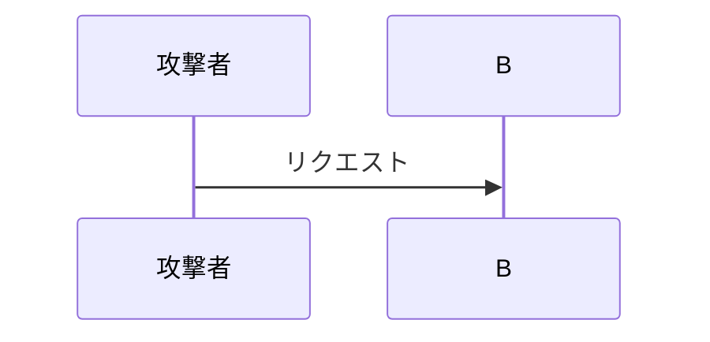

# 使える Markdown と、壊れる書き方

本文は `apps/articles/scripts/markdown.js` が markdown-it + Shiki で HTML にする。

## 数式

区切りは **LaTeX 標準の `\[...\]`（ブロック）と `\(...\)`（インライン）**。

```markdown
\[
\sum_{n=2}^{100000} \sqrt{n} \approx \frac{2}{3} \cdot 100000^{1.5}
\]

文中に \(E = mc^2\) と書ける。
```

**`$` は数式の区切りではない。** 記事には PHP の `$search` や Makefile の
`$$(seq $(BLOCKS))` が普通に出てくるので、`$` を目印にすると本文が壊れる。

KaTeX がビルド時に HTML + MathML にするので、閲覧側に JS は要らない。
式が壊れていてもビルドは止まらず、`WARN` を出して原文がそのまま出る。
**ビルドログの `WARN` を見逃さない。**

## 図（mermaid）

````markdown

````

mermaid はハイライトされず、そのまま渡って描画される。
図を含むページにだけ描画スクリプトが付く。

**AI に生成させた画像は使わない。** 意味のない挿絵が入るのを避けるためのルール。
図が要るなら mermaid で書く。

**実機のスクリーンショットは使ってよい。** 画面そのものが証拠になるもの
（同意画面、エラーダイアログ、管理コンソール）は、文章や ASCII で描き直すより正確で速い。
デッキ直下の `images/` に置けば、ビルドが出力先にコピーしてパスも書き換える。

```markdown

```

`img` / `images` / `assets` のどれかの名前なら拾われる。

## コードブロック

言語指定は Shiki が解釈する。知らない言語はプレーンテキストに落ちるので
ビルドは止まらない。

実際に使われている言語: `ts` `tsx` `js` `php` `go` `python` `hcl` `bash` `sh`
`console` `json` `jsonc` `yaml` `makefile` `markdown` `html` `text`

## 用語の補足

読者に馴染みのない単語は、引用ブロックで都度補う。

```markdown
> **用語: PoW(Proof of Work)**
> 直訳すると「作業の証明」。ある条件を満たす答えを力任せに探させる仕組みで、
> 探すのは大変だが、合っているかの確認は一瞬で終わる。
```

読み飛ばしても本筋が追えるように書く。

## 表

数字の比較は表にする。右揃えにしたい列は `---:` を使う。

```markdown
| 項目 | 結果 |
| --- | ---: |
| 1 プロセス | 2 分 02 秒 |
| 8 並列 | 38 秒 |
```

## 見出し

本文の `#` は使わない（タイトルは frontmatter 由来の h1 が別に出る）。
本文先頭に `# 見出し` を置いた場合、タイトルとして使われ本文からは落ちる。
