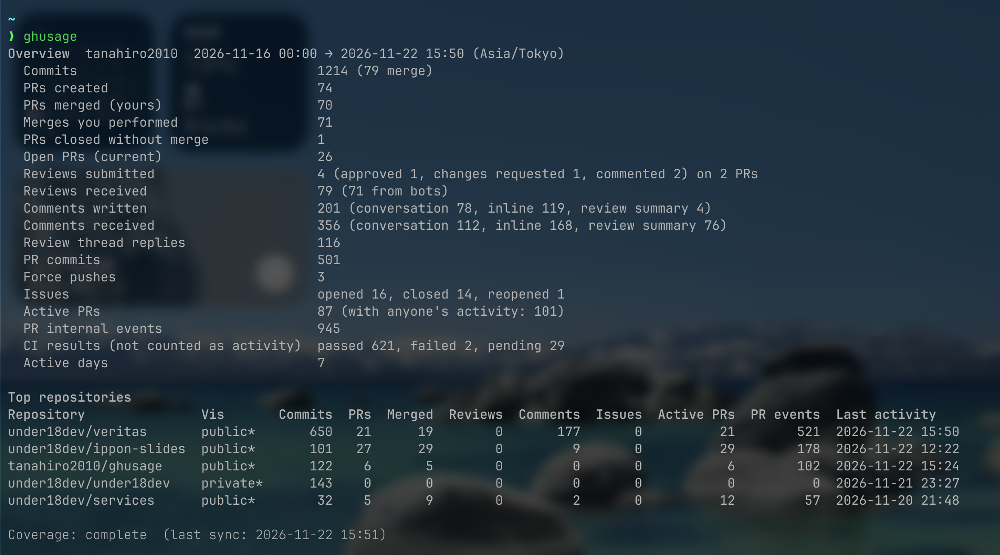
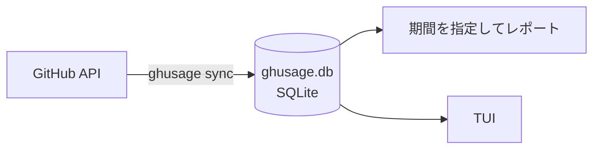
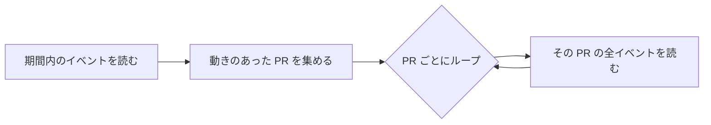
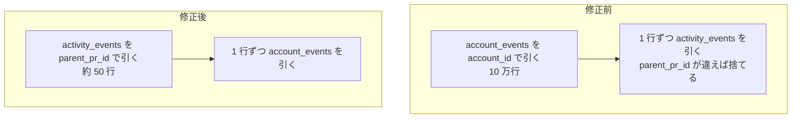

# SQLiteのJOIN順序を変えたら、処理が173秒から1秒になった話

> `JOIN` を `CROSS JOIN` に書き換えたら、173 秒が 1 秒になりました。

## この記事の結論

自作の CLI ツール ghusage で PR ごとにCIの長さにストレスを感じていたら、SQLite のキャッシュからレポートを作る処理が 1 回 173 秒かかっていました。`JOIN` を `CROSS JOIN` に書き換えてループの順番を固定したら、1 秒台になりました。wow

- 原因は、SQLite がネストしたループの外側と内側を逆に選んでいたこと
- 逆を選んだのは、SQLite がテーブルの統計を持っていなかったから
- `EXPLAIN QUERY PLAN` にはどちらの行も `SEARCH` と出ていて、計画だけ見ても遅さに気づけなかった

| 条件 | 修正前 | 修正後 |
| --- | ---: | ---: |
| CI（macos-15、7 日分の集計を 1 回、デバッグビルド） | 173 秒 | 1.7〜2.1 秒 |
| CI（macos-15、30 日分） | 240 秒 | 2.3〜2.7 秒 |
| 手元の再現（2,000 回のクエリ、統計なし） | 260.8 秒 | 0.79 秒 |
| 手元の再現（同上、`ANALYZE` 後） | 0.33 秒 | 0.43 秒 |

ちなみに、ghusage は GitHub での自分の活動を、PR の中で起きたことまで含めて集計する CLI / TUI です。`npm install -g ghusage` で入ります。

- ドキュメント: https://ghusage.under18.dev/ja/
- ソースコード: https://github.com/tanahiro2010/ghusage

そして、この記事で一番伝えたいことを先に書いておきます。

**`EXPLAIN QUERY PLAN` の `SEARCH` は「速い」という意味ではありません。** `SEARCH` はインデックスで絞り込んだことを示すだけで、絞り込んだ結果が何行残るかは教えてくれません。左端の列が全行同じ値のインデックスなら、`SEARCH` でも全件読むのと変わらない。そして SQLite は、統計がなければそのことを知りません。

> この記事は LT「SQLiteのJOIN順序を変えたら、処理が173秒から1秒になった話」の内容に、発表では話しきれなかった再現実験と、SQLite のプランナの挙動を足したものです。SQLite を組み込みで使っていて、JOIN を書いたことがある人向けです。

---

## 1. ghusage とは(宣伝)

[ghusage](https://ghusage.under18.dev/ja/) は、GitHub での自分の活動を集計する CLI とターミナル UI です。Rust で書いていて、npm から入れられます。

```sh
npm install -g ghusage
ghusage sync              # 直近 30 日分を取ってくる
ghusage                   # 直近 7 日の概要
ghusage tui               # ターミナル UI
```

キャッチコピーは「GitHub で実際に何をしたのかを把握する」。

GitHub のプロフィールの草（コントリビューショングラフ）は、何日に何回活動したかしか教えてくれません。ghusage は PR を「過程」として扱います。PR の中のコミット、レビューとその状態、インラインコメントと会話コメントの違い、レビュースレッド、フォースプッシュまで含めて、誰がいつ何をしたかを数えます。

僕の直近 1 週間を実際に出すと、こうなります。



もらったレビュー 79 件のうち 71 件はボットです。自分の PR がマージされた回数（70）と、自分がマージした回数（71）も別の行になっています。CI は 621 回通っていますが、「not counted as activity」のとおり自分の活動には数えません。

こだわっているのは数え方です。

- **自分、ほかの人、ボットを分けて数える。** 書いたコメントと受けたコメント、自分が行ったマージと自分の PR がマージされたことを区別します。CI の結果を自分の活動として数えることはありません
- **どの指標にも定義を書いている。** 「レビューした PR の数」のようなユニーク数にはそう明記します
- **抜けを隠さない。** どのレポートにもデータのカバレッジを出します。`--require-complete` を付ければ、取りきれていないデータでスクリプトを失敗させられます
- **ローカルで動く。** データはローカルの SQLite に保存して差分で同期します。`--offline` でネットワークなしでもレポートを出せます。テレメトリはありません
- **出力は表、JSON、CSV、TUI。** JSON はスキーマにバージョンを付けています

日次・週次・月次・年次のレポート、リポジトリごとの集計、PR 1 本のタイムライン表示（`ghusage pr <URL> --timeline`）もあります。詳しくはドキュメントを見てください。

- ドキュメント: https://ghusage.under18.dev/ja/
- GitHub: https://github.com/tanahiro2010/ghusage
- npm: https://www.npmjs.com/package/ghusage

## 2. 前提：レポートはすべて SQLite のキャッシュから作る

ghusage は、GitHub API のレスポンスから直接レポートを計算しません。まず GitHub のデータをローカルの SQLite データベース（`ghusage.db`）に保存し、CLI のレポートも TUI も、すべてこのキャッシュから作ります。SQLite は `rusqlite` の `bundled` 機能で同梱していて、バージョンは 3.54.1 です。



レポートのたびに走るのは右半分、キャッシュを読んで集計する部分です。今回遅かったのもここでした。

### イベントとアカウント

キャッシュの中心は 2 つのテーブルです。

```sql
CREATE TABLE activity_events (
    event_id      TEXT NOT NULL PRIMARY KEY,
    parent_pr_id  TEXT REFERENCES pull_requests(id),
    occurred_at   INTEGER NOT NULL,
    -- ほかの列は省略
);
CREATE INDEX activity_events_parent_pr ON activity_events(parent_pr_id)
    WHERE parent_pr_id IS NOT NULL;

CREATE TABLE account_events (
    account_id  INTEGER NOT NULL REFERENCES accounts(id) ON DELETE CASCADE,
    event_id    TEXT NOT NULL REFERENCES activity_events(event_id) ON DELETE CASCADE,
    PRIMARY KEY (account_id, event_id)
) WITHOUT ROWID;
CREATE INDEX account_events_event ON account_events(event_id);
```

`activity_events` はイベント本体です。コミット、レビュー、コメント、マージ、フォースプッシュといった出来事が 1 行ずつ入り、PR の中で起きたものには `parent_pr_id` が付きます。

`account_events` は「どの分析対象のキャッシュに、どのイベントが入っているか」の対応表です。ghusage は認証したユーザー本人を分析するのが基本ですが、`--user` で別のアカウントを分析することもできます。同じイベントが複数の分析対象から見えることがあるので、イベント本体と対応表を分けています。

普段は自分 1 人しか分析しません。つまり `account_events` の `account_id` は、ほぼ全行が同じ値になります。今回の 173 秒は、ここから始まっていました。

### 期間外のイベントも読む理由

レポートを作るとき、ghusage はまず期間内のイベントを読みます。

それだけでは足りない指標があります。`ghusage prs --details` で出す自分の PR の所要時間、「Time to first review」（作成から最初のレビューまで）や「Creation to merge」（作成からマージまで）は、PR が期間の前に作られていたら、期間内のイベントだけでは計算できません。そこで、期間内に動きがあった PR については、期間の外のイベントも全部読みます。



ループの中で呼んでいたのがこのクエリです。

```sql
SELECT {EVENT_COLS} FROM activity_events e
JOIN account_events ae ON ae.event_id = e.event_id
WHERE ae.account_id = ?1 AND e.parent_pr_id = ?2
```

ある分析対象の、ある PR のイベントを全部取る。それだけのクエリです。`parent_pr_id` にはインデックスがあり、`account_events` は複合主キーを持っています。インデックスはちゃんと張ってありました。

## 3. 発端：CI がやたら遅い

2026 年 11 月 22 日の朝、CI がおかしいことに気づきました。

macOS のジョブだけで 10 分を超えています。ベンチマーク用のワークフローに至っては、1 時間のタイムアウトで cancelled を何回も繰り返していました。

ログを開いて、テストの行のタイムスタンプを順に追いました。

```console
macos-15 03:12:50.4055930 Testing cached 7-day aggregation (load + overview)
macos-15 03:15:43.5606920 Success
macos-15 03:15:43.5609030 Testing cached 30-day aggregation (load + overview)
macos-15 03:19:43.3846610 Success
```

7 日分の集計が 3 時 12 分 50 秒に始まって、3 時 15 分 43 秒に終わっています。

173 秒です。

### 計測：どの OS でも 2 分超え

このテストは `cargo test --workspace --all-targets` の中で走っているベンチマークです。キャッシュからの読み込みと概要レポートの集計を 1 セットで測っています。Criterion はテストモードで起動されると、各ベンチマークを 1 回だけ実行して `Testing ...` と `Success` を出力します。この 2 行のタイムスタンプの差を取れば、集計 1 回分の時間になります。

条件は、10 万イベント、2,000 PR、40 リポジトリのキャッシュで、デバッグビルドです。

| OS | 7 日分 | 30 日分 |
| --- | ---: | ---: |
| ubuntu-latest | 131.24 秒 | 168.91 秒 |
| macos-15 | 173.16 秒 | 239.82 秒 |
| windows-latest | 133.08 秒 | 172.47 秒 |

OS 固有の問題ではありません。どこでも 2 分を超えていました。

ベンチのデータでは、30 日の期間でもほぼ 2,000 PR すべてに動きがあります。つまり §2 のクエリは、集計 1 回につき約 2,000 回呼ばれていました。

## 4. `EXPLAIN QUERY PLAN` に `SEARCH` と出ていた

まず実行計画を見ました。

```console
QUERY PLAN
|--SEARCH ae USING PRIMARY KEY (account_id=?)
`--SEARCH e USING INDEX sqlite_autoindex_activity_events_1 (event_id=?)
```

SQLite の JOIN はネストしたループで実行されます。この計画の意味はこうです。

1. 外側のループで、`account_events` を主キーの `account_id = ?` で引く
2. 内側のループで、取れた 1 行ごとに `activity_events` を `event_id` で引く
3. `parent_pr_id = ?` に合わない行は捨てる

どちらの行も `SEARCH` で、インデックスも使っています。全件走査を意味する `SCAN` はどこにも出てきません。

問題なさそうに見えました。

### ハマりポイント①：`account_id` は全行同じ値だった

§2 で書いたとおり、ghusage は普段、自分 1 人しか分析しません。ベンチのキャッシュに入っているアカウントも 1 つだけで、`account_events` の `account_id` は 10 万行すべてが同じ値でした。

`account_id = 1` で絞り込んでも、10 万行がそのまま残ります。`SEARCH` と書いてあっても、やっていることは全件走査と変わりません。

それを PR の数だけ繰り返していました。

\[
100{,}000 \text{ 行} \times 2{,}000 \text{ 回} = 2 \text{ 億行}
\]

逆向きに回せば、`parent_pr_id` で絞った時点で 1 PR あたり約 50 行です。そこから `account_events` を 1 行ずつ確かめても、全部で 10 万行で済みます。



原因はこれだけです。外側と内側が逆だった。

## 5. なぜ SQLite は遅い方を選んだのか

INNER JOIN では、どちらのテーブルを外側にするかは SQLite が決めます。公式ドキュメントにもそう書いてあります。

> Inner joins can be freely reordered.

では、なぜ遅い方を選んだのか。

### 統計がないと「10 行くらい」と推定する

SQLite は、テーブルの中身がどれくらい偏っているかを `sqlite_stat1` という統計テーブルで知ります。この統計は `ANALYZE` を実行しないと作られません。

ghusage のコードには `ANALYZE` も `PRAGMA optimize` もありませんでした。

統計がないとき、SQLite はこう推定します。

> the default guess is that there are an average of 10 duplicates for every value in the left-most column of the index.

インデックスの左端の列は、1 つの値につき平均 10 行くらいだろう、という推定です。

この推定を今回のクエリに当てはめると、こうなります。

- `account_events` を `account_id = ?` で引く → 10 行くらい
- `activity_events` を `parent_pr_id = ?` で引く → 10 行くらい

どちらから回しても同じコストに見えます。実際の行数は 10 万行と 50 行で 2,000 倍違うのに、SQLite にはその差が見えていませんでした。

そして、悪い方を引きました。

### 公式はこれを low-quality index と呼んでいる

SQLite の公式ドキュメントには、このパターンを名指しした節があります。

> A low-quality index (for the purpose of this checklist) is one where there are more than 10 or 20 rows in the table that have the same value for the left-most column of the index.

> If you must use a low-quality index, be sure to run ANALYZE.

インデックスの左端の列に、同じ値が 10〜20 行以上あるもの。`account_events` の主キー `(account_id, event_id)` は、左端の `account_id` が全行同じなので、この定義にそのまま当てはまります。

複合主キーの列の順番として `(account_id, event_id)` は自然です。「あるアカウントのイベントを全部取る」クエリには最適で、実際 ghusage の他のクエリはその形で使っています。それが利用者 1 人という前提と組み合わさると、ループの外側に置かれたときだけ罠になります。

## 6. 直し方：`CROSS JOIN` で順序を固定する

修正後のクエリです。

```sql
SELECT {EVENT_COLS} FROM activity_events e
CROSS JOIN account_events ae ON ae.event_id = e.event_id
WHERE e.parent_pr_id = ?2 AND ae.account_id = ?1
```

`JOIN` を `CROSS JOIN` に変えただけです。

SQLite は `CROSS JOIN` の左右を入れ替えないと決めています。

> The CROSS JOIN operator is commutative, in theory. However, SQLite chooses to never reorder tables in a CROSS JOIN. This provides a mechanism by which the programmer can force SQLite to choose a particular loop nesting order.

書いた順のまま `activity_events` が外側、`account_events` が内側になります。

> **用語: CROSS JOIN**
> 標準 SQL では、`ON` のない `CROSS JOIN` は直積（全組み合わせ）を意味します。`ON` 付きの `CROSS JOIN` は INNER JOIN と同じ結果を返します。「順序を入れ替えない」のは SQLite 独自の扱いで、PostgreSQL や MySQL で同じことをしても順序は固定されません。

修正後の実行計画はこうなりました。

```console
QUERY PLAN
|--SEARCH e USING INDEX activity_events_parent_pr (parent_pr_id=?)
`--SEARCH ae USING COVERING INDEX account_events_event (event_id=? AND account_id=?)
```

2 行目に `COVERING INDEX` と出ているのにも理由があります。`account_events` は `WITHOUT ROWID` のテーブルなので、セカンダリインデックス `account_events_event(event_id)` には主キーの列 `account_id` も一緒に入っています。`event_id` と `account_id` の両方をインデックスだけで確かめられるので、テーブル本体を読みに行きません。

1 行目の `activity_events_parent_pr` は `WHERE parent_pr_id IS NOT NULL` 付きの部分インデックスです。クエリ側に `e.parent_pr_id = ?2` があるので、SQLite は「この行は NULL ではない」と判断して部分インデックスを使えます。

WHERE 句の条件の順番も入れ替えていますが、これは読みやすさのためです。SQLite は WHERE 句の順番で計画を変えません。順序を決めているのは `CROSS JOIN` の方です。

### 実行計画をテストにした

`JOIN` に戻されたら、また 173 秒に戻ります。見た目は普通の JOIN の方が自然なので、誰かが「なんで CROSS JOIN？」と書き換える可能性は十分あります。未来の自分も含めて。

そこで、実行計画そのものをテストにしました。

```rust
/// Events of one pull request seen by an account. `CROSS JOIN` keeps
/// SQLite from driving the join from `account_events`, which would scan every
/// event of the account once per pull request.
fn pr_events_sql() -> String {
    format!(
        "SELECT {EVENT_COLS} FROM activity_events e \
         CROSS JOIN account_events ae ON ae.event_id = e.event_id \
         WHERE e.parent_pr_id = ?2 AND ae.account_id = ?1"
    )
}

#[test]
fn pull_request_events_are_found_through_the_parent_index() {
    let dir = tempfile::tempdir().unwrap();
    let store = Store::open(&dir.path().join("t.db")).unwrap();
    let plan: Vec<String> = query_list(
        &store.conn,
        &format!("EXPLAIN QUERY PLAN {}", pr_events_sql()),
        params![1, "PR_x"],
        |r| Ok(r.get::<_, String>(3)?),
    )
    .unwrap();
    assert!(
        plan[0].contains("activity_events_parent_pr"),
        "unexpected plan: {plan:?}"
    );
}
```

`EXPLAIN QUERY PLAN` の 4 列目が計画の説明文です。1 行目、つまり外側のループに `activity_events_parent_pr` が出ていることを確かめています。

このテストは空のデータベースで走ります。データ量に依存しないので速く、CI で毎回回せます。逆に言えば、データが入ったときの計画は確かめていません。統計なしの空のデータベースと、統計なしの 10 万行のデータベースで計画が同じになることは、次の節の再現で確かめました。

### 計測：修正後の CI

修正コミットの前後で、push 時の CI の run を比べました。2 つの run の間にあるのは修正コミット 1 つだけです。

| OS | 7 日分 | 30 日分 |
| --- | ---: | ---: |
| ubuntu-latest | 131.24 秒 → 1.97 秒 | 168.91 秒 → 2.55 秒 |
| macos-15 | 173.16 秒 → 1.67 秒 | 239.82 秒 → 2.29 秒 |
| windows-latest | 133.08 秒 → 2.23 秒 | 172.47 秒 → 2.92 秒 |

タイトルの「1 秒」は macOS の 7 日分の 1.67 秒です。どの OS でもだいたい 70〜100 倍速くなりました。

デバッグビルドで 1 回だけ流した時間なので、ばらつきはあります。同じコミットの別の run では、Ubuntu の 7 日分が 1.34 秒でした。

## 7. 手元で再現する

CI のログだけだと、本当にループの向きが原因なのか、他の要素が混ざっていないのかが分かりません。ghusage のスキーマから関係する列とインデックスだけを抜き出して、手元で再現しました。

データは、10 万イベント、2,000 PR、5 件に 1 件は PR に属さないイベント、アカウントは 1 つです。ghusage のベンチマークのデータの形に合わせています。

```sql
CREATE TABLE activity_events (
  event_id TEXT NOT NULL PRIMARY KEY, event_type TEXT NOT NULL,
  parent_pr_id TEXT, occurred_at INTEGER NOT NULL, meta TEXT NOT NULL);
CREATE INDEX activity_events_occurred ON activity_events(occurred_at);
CREATE INDEX activity_events_parent_pr ON activity_events(parent_pr_id) WHERE parent_pr_id IS NOT NULL;
CREATE TABLE account_events (
  account_id INTEGER NOT NULL, event_id TEXT NOT NULL,
  PRIMARY KEY (account_id, event_id)) WITHOUT ROWID;
CREATE INDEX account_events_event ON account_events(event_id);
WITH RECURSIVE n(i) AS (SELECT 0 UNION ALL SELECT i+1 FROM n WHERE i < 99999)
INSERT INTO activity_events
SELECT 'EV_'||i, CASE WHEN i%5=0 THEN 'commit' ELSE 'review' END,
       CASE WHEN i%5=0 THEN NULL ELSE 'PR_'||(i%2000) END,
       1700000000 + i*315, '{}' FROM n;
INSERT INTO account_events SELECT 1, event_id FROM activity_events;
```

これに対して、2,000 PR 分のクエリを流す Python スクリプトを書きました。

```python
import sqlite3, sys, time
OLD="SELECT e.* FROM activity_events e JOIN account_events ae ON ae.event_id = e.event_id WHERE ae.account_id = ?1 AND e.parent_pr_id = ?2"
NEW="SELECT e.* FROM activity_events e CROSS JOIN account_events ae ON ae.event_id = e.event_id WHERE e.parent_pr_id = ?2 AND ae.account_id = ?1"
db=sys.argv[1]; analyze=len(sys.argv)>2
c=sqlite3.connect(db)
print("sqlite", sqlite3.sqlite_version, "analyze" if analyze else "no-stats")
if analyze: c.execute("ANALYZE")
else: c.execute("DROP TABLE IF EXISTS sqlite_stat1")
for name,q in (("old",OLD),("new",NEW)):
    plan=[r[3] for r in c.execute("EXPLAIN QUERY PLAN "+q,(1,"PR_7"))]
    for _ in range(2):
        t=time.perf_counter(); n=0
        for p in range(2000):
            n+=len(c.execute(q,(1,f"PR_{p}")).fetchall())
        dt=time.perf_counter()-t
    print(f"{name}: {dt:.2f}s rows={n} plan={plan}")
```

2 周流して、2 周目の時間を記録しています。

旧クエリは 2 周で 9 分近くかかりました。新クエリの番になると、一瞬で終わりました。

### 計測：統計なしだと 330 倍

環境は macOS 26.5、Apple M4、Python 3.10.4 の `sqlite3` モジュール（SQLite 3.51.0）です。

| クエリ | 2,000 回の合計 | 外側のループ |
| --- | ---: | --- |
| `JOIN` | 260.82 秒 | `SEARCH ae USING PRIMARY KEY (account_id=?)` |
| `CROSS JOIN` | 0.79 秒 | `SEARCH e USING INDEX activity_events_parent_pr` |

約 330 倍です。

返ってきた行数はどちらも 80,000 行で、結果は同じでした。

実行計画も CI 上の ghusage と同じ形になりました。ループの向きだけで、この差が出ます。

## 8. `ANALYZE` すると、元のクエリのままで速くなる

ここが一番確かめたかったところです。

統計がないことが原因なら、統計を作れば SQLite は自分で正しい方を選ぶはずです。同じデータベースで `ANALYZE` を 1 回流してから、同じことをしました。

### 計測：`ANALYZE` 後

| クエリ | 2,000 回の合計 | 外側のループ |
| --- | ---: | --- |
| `JOIN` | 0.33 秒 | `SEARCH e USING INDEX activity_events_parent_pr` |
| `CROSS JOIN` | 0.43 秒 | `SEARCH e USING INDEX activity_events_parent_pr` |

元の `JOIN` のままで 0.33 秒になりました。実行計画も `CROSS JOIN` と同じです。

0.33 秒と 0.43 秒の差は 1 回の計測なので、誤差の範囲だと思います。

### 考察：`sqlite_stat1` に何が入ったのか

`ANALYZE` 後の `sqlite_stat1` はこうなっていました。

```text
account_events|account_events_event|100000 1
account_events|account_events|100000 100000 1
activity_events|activity_events_parent_pr|80000 50
activity_events|activity_events_occurred|100000 1
activity_events|sqlite_autoindex_activity_events_1|100000 1
```

3 列目の数字は「行数、左端の列 1 値あたりの行数、左から 2 列目までで 1 値あたりの行数、……」の順です。

- `account_events|account_events|100000 100000 1` は、主キーで `account_id` だけを指定すると 100,000 行、`event_id` まで指定すると 1 行、という意味です
- `activity_events_parent_pr|80000 50` は、部分インデックスに 80,000 行あって、`parent_pr_id` 1 値あたり 50 行という意味です

統計なしのときはどちらも「10 行くらい」でした。100,000 行と 50 行だと分かれば、SQLite が迷う理由はありません。

### 公式もそう言っている

SQLite の公式ドキュメントには、2024 年にこういう追記があります。

> Update 2024: The query planner has been improved so much over the years that you should never need to use any of the hacks described below. The capabilities described below are still available, for backwards compatibility. But you shouldn't use them.

この「hacks」の中に、`unlikely()` と並んで「CROSS JOIN でループの順序を固定する」方法が入っています。公式がその前に勧めているのは、low-quality index を使うなら `ANALYZE` を実行すること、そして `PRAGMA optimize` です。

> Applications with short-lived database connections should run "PRAGMA optimize;" once, just prior to closing each database connection.

今回の `CROSS JOIN` は、公式が「もう使わなくていいはず」と言っている手段でした。

### じゃあ `CROSS JOIN` は間違いだったのか

間違いだったとは思っていません。

`CROSS JOIN` は効果が確実です。統計の有無にも、データの分布にも、SQLite のバージョンによるプランナの変化にも左右されず、書いた順のまま動き、しかもそれをテストで固定できます。CI が 1 時間止まっている状況で、まず確実に直す手としては正しかったと思います。

ただ、根本の原因は統計の方です。ghusage には `PRAGMA optimize` を足す余地があります。

まだ考えることがあります。ghusage は、キャッシュのファイルに書き込み権限がないとき、読み取り専用（`SQLITE_OPEN_READ_ONLY`）で開き直してレポートだけは出せるようにしています。`ANALYZE` は `sqlite_stat1` に書き込むので、この接続からは実行できません。統計に頼るなら、読み取り専用で開いたときは統計なしで動くことになります。`CROSS JOIN` なら、その場合でも順序は変わりません。

`CROSS JOIN` を外して `PRAGMA optimize` に任せるかどうかは、データの規模を変えて比べてから決めます。

## 9. CI も速くなった

この修正で、CI 全体の時間も変わりました。§6 と同じ 2 つの run の、ステップごとの時間です。

| OS | `cargo test` | ジョブ全体 |
| --- | ---: | ---: |
| ubuntu-latest | 364 秒 → 92 秒 | 7.8 分 → 3.2 分 |
| ubuntu-24.04-arm | 588 秒 → 115 秒 | 11.3 分 → 3.3 分 |
| macos-15 | 509 秒 → 78 秒 | 10.7 分 → 3.0 分 |
| macos-15-intel | 553 秒 → 204 秒 | 13.3 分 → 8.2 分 |
| windows-latest | 467 秒 → 175 秒 | 11.2 分 → 6.4 分 |

macOS の `cargo test` 509 秒のうち、このベンチマーク 2 本だけで 413 秒（173 + 240）を占めていました。

CI 全体の待ち時間は、いちばん遅いジョブで決まります。約 13 分から約 8 分になりました。今のボトルネックは macos-15-intel の 8.2 分です。

ユーザーの手元の集計だけでなく、開発のループも速くなりました。

## 10. 次に速くできそうなところ

同じ形の JOIN が、もう 1 つあります。期間内のイベントを読む最初のクエリです。

```sql
SELECT {EVENT_COLS} FROM activity_events e
JOIN account_events ae ON ae.event_id = e.event_id
WHERE ae.account_id = ?1
AND ((e.occurred_at BETWEEN ?2 AND ?3) OR (e.author_date BETWEEN ?2 AND ?3))
```

§7 の簡略化したスキーマで、`OR` の片側（`occurred_at`）だけにして実行計画を見たところ、統計なしでは外側が `account_events` の主キーになりました。

```console
QUERY PLAN
|--SEARCH ae USING PRIMARY KEY (account_id=?)
`--SEARCH e USING INDEX sqlite_autoindex_activity_events_1 (event_id=?)
```

こちらはループの中ではなく 1 回だけなので、10 万行を 1 回読むだけです。173 秒のような桁の話にはなりません。それでも、30 日分なら 8,000 行程度で済むところを 10 万行読んでいます。実際のスキーマには `author_date` の部分インデックスと `OR` があるので、計画が同じになるかは ghusage 本体で確かめてからです。

`PRAGMA optimize` を入れれば、こちらも一緒に速くなるはずです。§8 の比較と合わせて、次に試します。

## 11. まとめ

- 173 秒かかっていた原因は、ネストしたループの外側と内側が逆だったこと
- `JOIN` を `CROSS JOIN` に変えて順序を固定したら、1 秒台になった
- SQLite が逆を選んだのは、統計がなく、どちらのインデックスも「1 値あたり 10 行くらい」に見えていたから
- `ANALYZE` を流せば、元の `JOIN` のままでも SQLite は正しい順序を選ぶ。公式もそちらを勧めている
- ついでに CI の待ち時間も約 13 分から約 8 分になった

`EXPLAIN QUERY PLAN` に `SEARCH` と出ていたら、そのインデックスで何行残るのかまで考えてください。利用者が 1 人のアプリ、テナントが 1 つの環境、フラグ列が先頭のインデックス。左端の列が全行同じ値になる場面は、思っているより多いはずです。

### 参考

- [tanahiro2010/ghusage](https://github.com/tanahiro2010/ghusage) — 本記事の対象。修正は `crates/ghusage-storage/src/lib.rs`
- [コミット 4ff1ddf](https://github.com/tanahiro2010/ghusage/commit/4ff1ddf07b06fdaeb6826e533252e929c329fa59) — `CROSS JOIN` への修正と実行計画のテスト
- [The SQLite Query Optimizer Overview](https://www.sqlite.org/optoverview.html) — 7 章 Joins。INNER JOIN の並べ替え、`CROSS JOIN` を並べ替えない扱い、統計なしの推定値（1 値あたり 10 行）
- [The Next-Generation Query Planner](https://www.sqlite.org/queryplanner-ng.html) — 「Checklist For Avoiding Or Fixing Query Planner Problems」。low-quality index の定義と、2024 年の「hacks はもう要らない」という追記
- [PRAGMA optimize](https://www.sqlite.org/pragma.html#pragma_optimize) — 接続の寿命に応じた `PRAGMA optimize` の推奨の流し方
