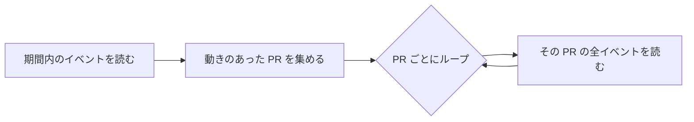
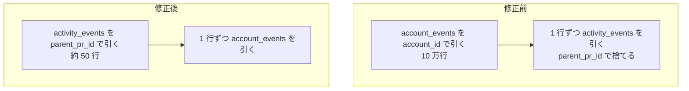

# SQLiteのJOIN順序を変えたら、処理が173秒から1秒になった話


## 記事を書くに当たって
`article-creater`スキルを読んでから書いてください。骨格（エピグラフ → この記事の結論 → 採番した本文）と
frontmatterの決まり、一次ソースの当たり方がそこにまとまっています。
記事はスライドの各セクションごとを増量し、そして技術的側面を追加して書くことを意識してください。
記事でも画像（実際のスクショなど、`img/` に置いたもの）は使えます。
marmaidなどで図を作ることはできます。
https://zenn.dev/meijin/articles/tech-article-output-recommend
これを参考に記事書いてください。

## 記事・スライド共通ドラフト

**状態メモ:** 数字はぜんぶ測り終わっています（CI ログ、手元の再現、公式ドキュメント）。裏取りの過程は `references.md` にあります。
ghusage は自分の OSS なので、公開を待つ相手はいません。

### 一次ソース

- ghusage リポジトリ: https://github.com/tanahiro2010/ghusage
  - 直したコミット `4ff1ddf`（2026-11-22 12:55 JST）: https://github.com/tanahiro2010/ghusage/commit/4ff1ddf07b06fdaeb6826e533252e929c329fa59
  - v0.1.2 リリース PR #4: https://github.com/tanahiro2010/ghusage/pull/4
- CI ログ（173 秒の出どころ）
  - 修正前 run 44979438123: https://github.com/tanahiro2010/ghusage/actions/runs/44979438123
  - 修正後 run 44982784864: https://github.com/tanahiro2010/ghusage/actions/runs/44982784864
- SQLite 公式
  - The SQLite Query Optimizer Overview（7 章 Joins）: https://www.sqlite.org/optoverview.html
  - The Next-Generation Query Planner（Checklist の節、2024 年の追記あり）: https://www.sqlite.org/queryplanner-ng.html
  - PRAGMA optimize: https://www.sqlite.org/pragma.html#pragma_optimize
- 同梱の SQLite は 3.54.1（`rusqlite 0.43` の `bundled`、`libsqlite3-sys 0.40.0`）

### 表現のルール（slide でも守る）

- 「173 秒 → 1 秒」はタイトルどおり使ってよい
  - 📌 記事の本文のどこかで、実測は 1.7〜2 秒くらいだったと一言添える
- ❌「SQLite のバグ」→ ⭕「統計が無いので、SQLite が悪い方を選んだ」
- ❌「CROSS JOIN を使えば速くなる」→ ⭕「CROSS JOIN で順序を固定したら直った。でも公式のおすすめは統計を取る方」
- 173 秒は **デバッグビルドで 1 回だけ** 流した時間。release ビルドの数字と混ぜない
- 「JOIN 順序」と「WHERE 句の順番」を混同しない。効いたのは CROSS JOIN の方で、WHERE の並べ替えではない

### タイトルまわり

- 題名：SQLiteのJOIN順序を変えたら、処理が173秒から1秒になった話
- 一言（記事冒頭のエピグラフ）

  > `JOIN` を `CROSS JOIN` に書き換えたら、173 秒が 1 秒になりました。

  - 候補②：EXPLAIN QUERY PLAN には「SEARCH」と出ていました。中身はほぼ全件走査でした。
  - 候補③：SQLite は悪くありませんでした。統計を渡していなかっただけです。
  - 📌 ①は §6、②は §4、③は §5 の話
- 発表者：田中博悠 / tanahiro2010
- 自己紹介：ghusage の作者
  - GitHub の開発活動を集計する Rust 製の CLI / TUI。キャッシュに SQLite を使っている

### つかみ

- 2026-11-22 の朝、CI がやたら遅い
  - macOS のジョブだけで 10 分超え
  - ベンチのワークフローは 1 時間で cancelled を繰り返していた
- ログを見たら、テスト 1 本に 173 秒かかっていた
  - 10 万イベントの集計を 1 回やるだけのテスト
- 直したのは SQL の `JOIN` を `CROSS JOIN` に変えただけ
  - 173 秒 → 1 秒
- 問いかけ：「`EXPLAIN QUERY PLAN` で `SEARCH` と出ていたら、安心してませんか？」

### この発表のスタンス

- 「CROSS JOIN 最強」で終わらせない。なぜ SQLite がそっちを選んだのかまで掘る
- 自分のコードの失敗談として出す。SQLite を責めない
- 手元で再現して、数字で見せる

---

### 0. ghusage の紹介（宣伝）

- キャッチコピー：「GitHub で実際に何をしたのかを把握する」
- GitHub での自分の活動を集計する CLI / TUI。Rust 製
  - `npm install -g ghusage` → `ghusage sync` → `ghusage`
- 草（コントリビューショングラフ）との違い
  - PR を「過程」として数える（コミット、レビュー、インラインコメント、フォースプッシュ）
  - 自分 / ほかの人 / ボットを分ける
  - 抜けを隠さない（どのレポートにもカバレッジ、`--require-complete`）
  - ローカルの SQLite、`--offline`、テレメトリなし
- 出力例は実際のスクショ `img/ghusage.png`（2026-11-16〜22 の自分の 1 週間）
- リンク
  - Docs: https://ghusage.under18.dev（日本語: https://ghusage.under18.dev/ja/）
  - GitHub: https://github.com/tanahiro2010/ghusage
  - npm: https://www.npmjs.com/package/ghusage（latest 0.1.2）
- 前提として押さえる仕組み
  - レポートも TUI も全部 SQLite のキャッシュ（`ghusage.db`）から作る
  - `account_events` は「どの分析対象のイベントか」。`--user` で他人も分析できる
  - 普段は自分 1 人 → `account_id` はほぼ全行同じ（§4 の伏線）
  - 期間外のイベントを読むのは `prs --details` の Time to first review / Creation to merge のため

### 1. ghusage と、遅くなった場所

- ghusage は GitHub の PR・レビュー・コミットを集計するツール
  - 取ってきたデータは SQLite にキャッシュする
- 期間（7 日、30 日など）を指定してレポートを出す
  - 期間内のイベントを読む
  - さらに、期間内に動きのあった PR は **期間外のイベントも全部** 読む
    - PR が開いてからマージされるまでの時間を正しく出すため
- この「PR ごとに全イベントを読む」クエリが遅かった
  - PR の数だけループで呼ばれる
  - ベンチのデータは 10 万イベント、2,000 PR



### 2. どれくらい遅かったか

- ✅ CI の `cargo test` のログから（デバッグビルド、10 万イベント、1 回だけ実行）

  | OS | 7 日分（前 → 後） | 30 日分（前 → 後） |
  | --- | --- | --- |
  | ubuntu-latest | 131 秒 → 2 秒 | 169 秒 → 3 秒 |
  | macos-15 | 173 秒 → 1 秒 | 240 秒 → 3 秒 |
  | windows-latest | 133 秒 → 2 秒 | 172 秒 → 3 秒 |

- どの OS でもだいたい 100 倍
- 📌 この数字はログの `Testing ...` と `Success` のタイムスタンプの差（📋 メモ①）
- 📌 Criterion はテストモードだと各ベンチを 1 回だけ流す。だから `cargo test` の中で測れている

### 3. 犯人のクエリ

- 修正前（`crates/ghusage-storage/src/lib.rs`）

  ```sql
  SELECT ... FROM activity_events e
  JOIN account_events ae ON ae.event_id = e.event_id
  WHERE ae.account_id = ?1 AND e.parent_pr_id = ?2
  ```

- テーブルは 2 つ
  - `activity_events`：イベント本体。`parent_pr_id` にインデックスあり
  - `account_events`：どのアカウントがどのイベントを見たか。主キーは `(account_id, event_id)`
- 見た目は普通の JOIN。インデックスもある
- なのに遅い

### 4. EXPLAIN QUERY PLAN を見る ―― SEARCH なのに全件

- ✅ 修正前の実行計画（📋 メモ②）

  ```
  |--SEARCH ae USING PRIMARY KEY (account_id=?)
  `--SEARCH e USING INDEX sqlite_autoindex_activity_events_1 (event_id=?)
  ```

- 外側のループが `account_events`、内側が `activity_events`
- `SEARCH` と出ているし、主キーも使っている。一見よさそう
- でも、利用者が 1 人なら `account_id` は **全行同じ値**
  - `account_id = 1` で絞っても 10 万行ぜんぶ残る
  - それを PR の数（2,000 回）だけ繰り返す
  - 10 万 × 2,000 = 2 億行
- 🔥 `SCAN` と出ないから安心、とは言えない



### 5. なぜ SQLite はそっちを選んだのか（🔥 山場その1）

- SQLite はテーブルの中身の偏りを知らなかった
  - 統計（`sqlite_stat1`）は `ANALYZE` を流さないと作られない
  - ghusage は `ANALYZE` も `PRAGMA optimize` も流していなかった
- 統計が無いときの推定（optoverview より）
  > the default guess is that there are an average of 10 duplicates for every value in the left-most column of the index.
  - `account_id = ?` も「10 行くらい」
  - `parent_pr_id = ?` も「10 行くらい」
  - どっちから回しても同じに見える → 悪い方を引いた
- 公式はこういうインデックスに名前をつけている（queryplanner-ng）
  > A low-quality index (...) is one where there are more than 10 or 20 rows in the table that have the same value for the left-most column of the index.
  - `account_events` の主キーはまさにこれ。左端の列が全行同じ値
- `ANALYZE` 後の統計（📋 メモ③）
  - `account_events`：`account_id` 1 値あたり 100,000 行
  - `activity_events_parent_pr`：1 値あたり 50 行
  - これが分かれば、SQLite は自分で正しい方を選ぶ（§7）

### 6. 直し方 ―― CROSS JOIN で順序を固定

- 修正後

  ```sql
  SELECT ... FROM activity_events e
  CROSS JOIN account_events ae ON ae.event_id = e.event_id
  WHERE e.parent_pr_id = ?2 AND ae.account_id = ?1
  ```

- SQLite は CROSS JOIN の左右を入れ替えない（optoverview 7 章）
  > SQLite chooses to never reorder tables in a CROSS JOIN.
  - 普通の INNER JOIN は自由に並べ替える
  - 📌 SQLite 独自の挙動。標準 SQL の CROSS JOIN にそういう意味はない
- 修正後の実行計画

  ```
  |--SEARCH e USING INDEX activity_events_parent_pr (parent_pr_id=?)
  `--SEARCH ae USING COVERING INDEX account_events_event (event_id=? AND account_id=?)
  ```

- ついでに実行計画をテストにした
  - `EXPLAIN QUERY PLAN` の 1 行目に `activity_events_parent_pr` が出ることを assert（📋 メモ④）
  - 誰かが `JOIN` に戻したら、テストで落ちる

### 7. 手元で再現した（🔥 山場その2）

- ✅ ghusage のスキーマから関係するところだけ抜いて再現（📋 メモ⑤）
  - 10 万イベント、2,000 PR、アカウント 1 つ
  - 2,000 PR 分のクエリを流した合計時間

  | | 旧 `JOIN` | 新 `CROSS JOIN` |
  | --- | ---: | ---: |
  | 統計なし | 260.8 秒 | 0.79 秒 |
  | `ANALYZE` 後 | 0.33 秒 | 0.43 秒 |

- 統計なしだと約 330 倍
- 🔥 `ANALYZE` を 1 回流すだけで、**旧クエリのままでも速くなる**
  - 実行計画も新クエリと同じになる
- 返ってくる行数はどれも 80,000 行。結果は変わらない
- 環境：macOS 26.5 / Apple M4 / Python 3.10.4 の sqlite3（SQLite 3.51.0）

### 8. じつは公式は CROSS JOIN をおすすめしていない

- queryplanner-ng のチェックリストに 2024 年の追記
  > Update 2024: The query planner has been improved so much over the years that you should never need to use any of the hacks described below.
  - その「hacks」に CROSS JOIN で順序を固定する方法が入っている
- 公式が先に言っているのは「low-quality index を使うなら ANALYZE しろ」
- `PRAGMA optimize` のおすすめ
  > Applications with short-lived database connections should run "PRAGMA optimize;" once, just prior to closing each database connection.
- じゃあ CROSS JOIN はダメだったのか
  - ダメではない。効果は確実で、テストで守れる
  - ただ根本は統計の方。次は `PRAGMA optimize` と比べたい（ghusage の PRD でも課題にしている）

### 9. CI もついでに速くなった

- ✅ 修正コミットの前後の CI（push run 2 本、間にあるのは `4ff1ddf` だけ）

  | OS | `cargo test` | ジョブ全体 |
  | --- | --- | --- |
  | ubuntu-latest | 364 秒 → 92 秒 | 7.8 分 → 3.2 分 |
  | ubuntu-24.04-arm | 588 秒 → 115 秒 | 11.3 分 → 3.3 分 |
  | macos-15 | 509 秒 → 78 秒 | 10.7 分 → 3.0 分 |
  | macos-15-intel | 553 秒 → 204 秒 | 13.3 分 → 8.3 分 |
  | windows-latest | 467 秒 → 175 秒 | 11.3 分 → 6.5 分 |

- CI 全体の待ち時間：約 13 分 → 約 8 分
- macOS の 509 秒のうち、このベンチ 2 本で 413 秒（173 + 240）
- ユーザーの手元だけじゃなく、開発のループも速くなった

### 10. まとめ

- 1 行の `JOIN` → `CROSS JOIN` で 173 秒が 1 秒になった
- 原因は SQLite が統計を持っていなかったこと
  - 左端の列が全部同じ値のインデックスは、統計が無いと罠になる
- `EXPLAIN QUERY PLAN` の `SEARCH` は「速い」の意味じゃない
  - 何行引くのかまで考える
- 本当は `ANALYZE` / `PRAGMA optimize` で直すのが筋
- 実行計画はテストで守れる
- ついでに CI の待ち時間も約 13 分 → 約 8 分

### 検証前チェックリスト

- [x] CI ログから修正前後の時間を取る（📋 メモ①）
- [x] 実行計画を修正前後で取る（📋 メモ②）
- [x] 手元で再現する（📋 メモ⑤）
- [x] `ANALYZE` ありで比べる
- [ ] 同梱の SQLite 3.54.1 でも同じ計画になるか確かめる
- [ ] `PRAGMA optimize` を接続を閉じるときに流した場合を測る
- [ ] アカウントが複数あるときに計画が変わるか確かめる

### メモ（サンプルコード・資料）

#### メモ① CI ログから時間を取る

```sh
gh run view 44979438123 -R tanahiro2010/ghusage --log \
  | grep -A1 -E "Testing cached" \
  | grep -E "\((macos-15|ubuntu-latest|windows-latest)\)"
```

```
macos-15 03:12:50.4055930 Testing cached 7-day aggregation (load + overview)
macos-15 03:15:43.5606920 Success
macos-15 03:15:43.5609030 Testing cached 30-day aggregation (load + overview)
macos-15 03:19:43.3846610 Success
```

- 03:12:50 → 03:15:43 で 173 秒

#### メモ② 実行計画の比較

```sql
EXPLAIN QUERY PLAN
SELECT e.* FROM activity_events e
JOIN account_events ae ON ae.event_id = e.event_id
WHERE ae.account_id = 1 AND e.parent_pr_id = 'PR_7';
-- |--SEARCH ae USING PRIMARY KEY (account_id=?)
-- `--SEARCH e USING INDEX sqlite_autoindex_activity_events_1 (event_id=?)

EXPLAIN QUERY PLAN
SELECT e.* FROM activity_events e
CROSS JOIN account_events ae ON ae.event_id = e.event_id
WHERE e.parent_pr_id = 'PR_7' AND ae.account_id = 1;
-- |--SEARCH e USING INDEX activity_events_parent_pr (parent_pr_id=?)
-- `--SEARCH ae USING COVERING INDEX account_events_event (event_id=? AND account_id=?)
```

#### メモ③ ANALYZE 後の sqlite_stat1

```
account_events|account_events_event|100000 1
account_events|account_events|100000 100000 1
activity_events|activity_events_parent_pr|80000 50
activity_events|activity_events_occurred|100000 1
activity_events|sqlite_autoindex_activity_events_1|100000 1
```

- `account_events|account_events|100000 100000 1` の 2 つ目の数字が「account_id 1 値あたりの行数」

#### メモ④ 実行計画のテスト（ghusage の `4ff1ddf`）

```rust
#[test]
fn pull_request_events_are_found_through_the_parent_index() {
    let dir = tempfile::tempdir().unwrap();
    let store = Store::open(&dir.path().join("t.db")).unwrap();
    let plan: Vec<String> = query_list(
        &store.conn,
        &format!("EXPLAIN QUERY PLAN {}", pr_events_sql()),
        params![1, "PR_x"],
        |r| Ok(r.get::<_, String>(3)?),
    )
    .unwrap();
    assert!(
        plan[0].contains("activity_events_parent_pr"),
        "unexpected plan: {plan:?}"
    );
}
```

#### メモ⑤ 手元の再現

- スクリプト：`sandbox/join-order/make.sql`、`sandbox/join-order/run.py`

```sh
cd sandbox/join-order
sqlite3 t.db < make.sql
python3 -I run.py t.db                              # 統計なし
cp t.db t2.db && python3 -I run.py t2.db analyze    # ANALYZE あり
```

```
sqlite 3.51.0 no-stats
old: 260.82s rows=80000
new: 0.79s rows=80000
sqlite 3.51.0 analyze
old: 0.33s rows=80000
new: 0.43s rows=80000
```
