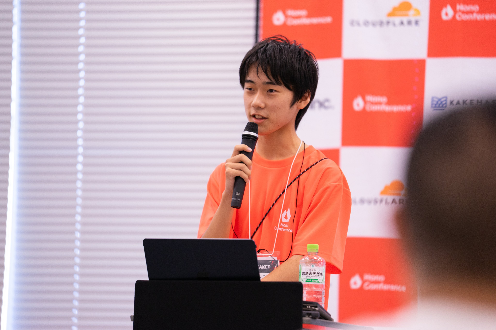
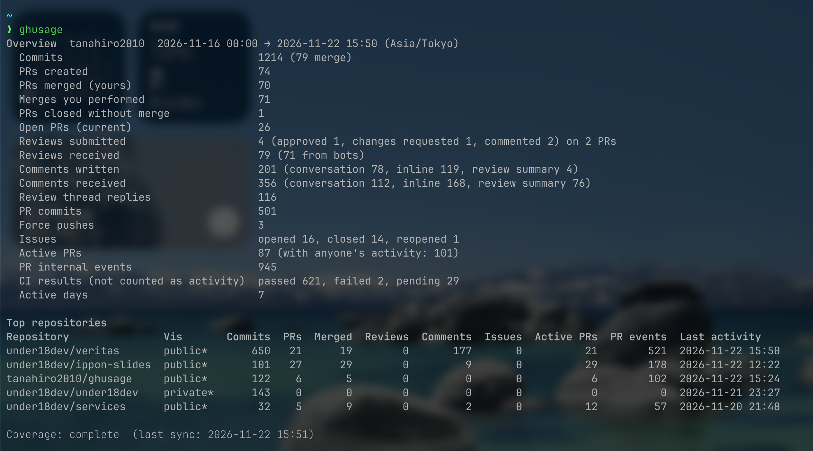
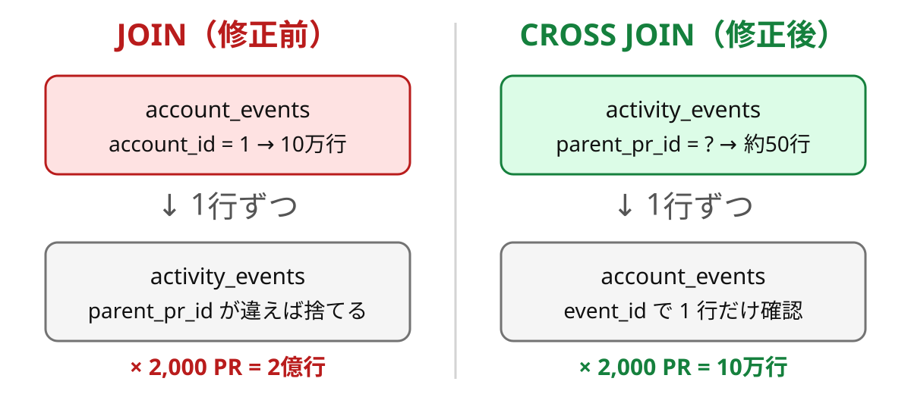

::title::

# SQLiteのJOIN順序を変えたら、処理が173秒から1秒になった話

田中博悠 / tanahiro2010

::note::

「SQLiteのJOIN順序を変えたら、処理が173秒から1秒になった話」をします。田中博悠です。よろしくお願いします。

> ▶ 全 32 枚・想定 6 分。巻くなら ①テストにした（Rust のコード）→ ②公式もそう言ってる → ③CI も速くなった の順で落とす。

---

## 田中博悠 / tanahiro2010

- 三田学園高等学校 1年
- ghusage を作ってる

::right::



::note::

高校 1 年です。最近は ghusage というツールを Rust で作っています。今日はそのツールを速くした話です。

> ▶ **15 秒で切る。**

---

## 今日話すこと

- ghusage の紹介
- 集計が 173 秒かかってた
- JOIN を CROSS JOIN にしたら 1 秒になった
- なんで SQLite は遅い方を選んだのか

::note::

今日話すのはこの 4 つです。まず ghusage の紹介をして、そのあと本題です。集計に 173 秒かかっていた。JOIN を CROSS JOIN に変えたら 1 秒になった。で、そもそもなんで SQLite は遅い方を選んだのか。最後のが本題です。

---

## ghusage

- GitHub で実際に何をしたのかを把握する
- 自分の活動を集計する CLI / TUI
- Rust 製・npm で入る

```sh
npm install -g ghusage
ghusage sync
ghusage
```

::note::

改めて ghusage の紹介です。GitHub で自分が実際に何をしたのかを把握するための、CLI とターミナル UI です。Rust で書いていて、npm install 一発で入ります。sync してから ghusage と打つと、直近 7 日のレポートが出ます。

---

## こういうのが出る

::wide::



::note::

実際に自分の 1 週間を出してみたのがこれです。コミットが 1,214、作った PR が 74。レビューは 79 件もらっていますが、そのうち 71 件はボットです。こういうふうに、自分とほかの人とボットを分けて数えます。CI の結果も出しますが、自分の活動としては数えません。

> ▶ 数字を全部読まない。「71 from bots」だけ指す。

---

## 草だけじゃわからない

- PR を「過程」として数える
  - コミット・レビュー・インラインコメント・フォースプッシュ
- 自分 / ほかの人 / ボットを分ける
- 抜けを隠さない
  - どのレポートにもカバレッジを出す

::note::

GitHub の草だと、何日に何回活動したかしか分かりません。ghusage は PR の中で何が起きたかまで数えます。自分のコメントと受けたコメント、自分がやったマージと自分の PR がマージされたこと、こういうのを全部分けて数えます。取りきれていないデータがあれば、それもちゃんと表示します。

---

## 仕組み

- GitHub API → `ghusage sync` → SQLite（`ghusage.db`）
- レポートも TUI も、全部この SQLite から作る
- 今回遅かったのはここ
  - キャッシュを読んで集計するところ

::note::

今日の話に関係する仕組みです。GitHub API から取ってきたデータは、いったん全部ローカルの SQLite に入れます。レポートも TUI も、この SQLite を読んで作ります。今回遅かったのは、この「キャッシュを読んで集計する」ところです。

---

## イベントとアカウント

- `activity_events` → コミット・レビュー・コメントなどのイベント
- `account_events` → どの分析対象のイベントか
  - `--user` でほかの人も分析できる
- 普段は自分 1 人
  - → `account_id` はほぼ全部同じ値

::note::

テーブルは 2 つ出てきます。activity_events がイベント本体で、account_events が、そのイベントがどの分析対象のものかを持つ対応表です。--user を付けるとほかの人も分析できるので、こういう形になっています。ただ、普段は自分 1 人しか分析しないので、account_id はほぼ全部同じ値になります。これ、あとで出てきます。

---

## ある日の CI

- macOS のジョブだけで 10 分超え
- ベンチのワークフローは 1 時間で cancelled
  - しかも何回も

::note::

11 月 22 日の朝、CI がやたら遅いことに気づきました。macOS のジョブだけで 10 分を超えていて、ベンチマークのワークフローは 1 時間のタイムアウトで何回も cancelled になっていました。

---

## ログを見る

```console
macos-15 03:12:50 Testing cached 7-day aggregation (load + overview)
macos-15 03:15:43 Success
macos-15 03:15:43 Testing cached 30-day aggregation (load + overview)
macos-15 03:19:43 Success
```

::note::

ログを見てみると、こうなっていました。7 日分の集計のテストが 3 時 12 分 50 秒に始まって、終わったのが 3 時 15 分 43 秒です。

> ▶ タイムスタンプを指でなぞるように指す。

---

::center size=2::

173 秒

::note::

173 秒です。テスト 1 本、集計 1 回で、3 分近くかかっていました。

> ▶ **一拍。**

---

## どの OS でも遅い

- macOS → 173 秒
- Windows → 133 秒
- Ubuntu → 131 秒

-# 10 万イベント・デバッグビルド・7 日分を 1 回

::note::

macOS だけの問題でもなくて、Windows でも Ubuntu でも 2 分を超えていました。データは 10 万イベントで、デバッグビルドで 1 回だけ流した時間です。

---

## 何をしてる？

- 期間内のイベントを読む
- 期間内に動いた PR は、期間外のイベントも全部読む
  - 作成 → 最初のレビュー、作成 → マージの時間を出すため
- PR ごとにクエリを 1 回
  - ベンチのデータは 2,000 PR

::note::

集計では、まず期間内のイベントを読みます。それに加えて、期間内に動きがあった PR については、期間の外のイベントも全部読みます。PR を作ってから最初のレビューが付くまで、マージされるまでの時間を出すためです。期間より前に作られた PR だと、期間内のイベントだけでは計算できません。このクエリが PR ごとに 1 回ずつ、ベンチのデータだと 2,000 回呼ばれます。

---

## 犯人のクエリ

```sql
SELECT ... FROM activity_events e
JOIN account_events ae ON ae.event_id = e.event_id
WHERE ae.account_id = ?1 AND e.parent_pr_id = ?2
```

- `activity_events` → イベント本体
- `account_events` → どのアカウントがどのイベントを見たか

::note::

これがそのクエリです。イベント本体の activity_events と、どのアカウントがどのイベントを見たかを持つ account_events を JOIN しているだけです。

---

## インデックスもある

- `activity_events(parent_pr_id)` にインデックス
- `account_events` の主キーは `(account_id, event_id)`
- 見た目は普通の JOIN

::note::

インデックスもちゃんと張ってあります。parent_pr_id にもインデックスがあるし、account_events は account_id と event_id の複合主キーです。見た目はごく普通の JOIN です。

---

## EXPLAIN QUERY PLAN

```console
|--SEARCH ae USING PRIMARY KEY (account_id=?)
`--SEARCH e USING INDEX sqlite_autoindex_activity_events_1 (event_id=?)
```

::note::

実行計画を見てみます。どっちの行も SEARCH で、主キーも使っています。SCAN、つまり全件走査は出てきません。

> ▶ 「SEARCH」の文字を指す。

---

## SEARCH って出てる

- でも利用者が 1 人なら `account_id` は全行同じ
- `account_id = 1` で絞っても 10 万行残る
- それを 2,000 回
  - 10 万 × 2,000 = 2 億行

::note::

でも、ghusage は基本的に 1 人で使うツールなので、account_id は全行同じ値なんです。account_id イコール 1 で絞っても、10 万行ぜんぶ残ります。それを PR の数、2,000 回繰り返していました。2 億行です。

> ▶ **ここが最初の山。** ゆっくり。

---

## 外側と内側が逆だった

::wide::



::note::

図にするとこうです。左が修正前で、10 万行を外側のループで回して、内側で parent_pr_id が違うものを捨てていました。右みたいに、parent_pr_id で 50 行くらいに絞ってから account_events を引けば、全部で 10 万行で済みます。

---

## なぜ？

::note::

じゃあ、なんで SQLite は左の遅い方を選んだのか。

> ▶ **一拍。**

---

## 統計がなかった

- SQLite は `ANALYZE` しないと中身の偏りを知らない
- ghusage は `ANALYZE` も `PRAGMA optimize` も流してなかった
- 統計なしだと「1 つの値につき 10 行くらい」と推定する
  - `account_id = ?` → 10 行くらい
  - `parent_pr_id = ?` → 10 行くらい

::note::

答えは、統計がなかったからです。SQLite は ANALYZE を流さないと、テーブルの中身がどれくらい偏っているかを知りません。統計がないときは、インデックスの 1 つの値につき 10 行くらいだろう、と推定します。account_id で絞っても 10 行、parent_pr_id で絞っても 10 行。どっちから回しても同じに見えるので、悪い方を引いてしまいました。

---

## 公式に名前がついてる

> A low-quality index (...) is one where there are more than 10 or 20 rows in the table that have the same value for the left-most column of the index.

> https://www.sqlite.org/queryplanner-ng.html

::note::

SQLite の公式ドキュメントには、これに名前がついています。low-quality index。インデックスの左端の列に、同じ値が 10 行とか 20 行以上あるもの。account_events の主キーは、左端の account_id が全行同じなので、まさにこれです。

---

## 直し方

```sql
SELECT ... FROM activity_events e
CROSS JOIN account_events ae ON ae.event_id = e.event_id
WHERE e.parent_pr_id = ?2 AND ae.account_id = ?1
```

- `JOIN` → `CROSS JOIN`

::note::

直し方はシンプルで、JOIN を CROSS JOIN に変えただけです。

---

## CROSS JOIN は並べ替えない

> SQLite chooses to never reorder tables in a CROSS JOIN.

> https://www.sqlite.org/optoverview.html

- 普通の JOIN は SQLite が自由に並べ替える
- CROSS JOIN は書いた順のまま
- SQLite 独自の挙動

::note::

SQLite は CROSS JOIN の左右を入れ替えない、と決めています。普通の JOIN だと SQLite が勝手に順番を入れ替えますが、CROSS JOIN なら書いた順のまま、activity_events が外側になります。ちなみにこれは SQLite 独自の挙動で、標準 SQL の CROSS JOIN にはそういう意味はありません。

---

## 修正後の実行計画

```console
|--SEARCH e USING INDEX activity_events_parent_pr (parent_pr_id=?)
`--SEARCH ae USING COVERING INDEX account_events_event (event_id=? AND account_id=?)
```

- 173 秒 → 1 秒

::note::

修正後の実行計画です。外側が parent_pr_id のインデックスになりました。これで 173 秒が 1 秒になりました。

> ▶ **聞かれたら:** CI ログの実測だと 1.7〜2 秒くらい。どの OS でもだいたい 100 倍。

---

## テストにした

```rust
#[test]
fn pull_request_events_are_found_through_the_parent_index() {
    let plan: Vec<String> = query_list(
        &store.conn,
        &format!("EXPLAIN QUERY PLAN {}", pr_events_sql()),
        params![1, "PR_x"],
        |r| Ok(r.get::<_, String>(3)?),
    )
    .unwrap();
    assert!(plan[0].contains("activity_events_parent_pr"));
}
```

::note::

ついでに、実行計画をテストにしました。EXPLAIN QUERY PLAN の 1 行目に parent_pr_id のインデックスが出ることを確かめています。誰かが JOIN に戻したら、このテストが落ちます。

---

## 手元で再現してみた

- 10 万イベント・2,000 PR・アカウント 1 つ
- 2,000 PR 分のクエリの合計
  - `JOIN` → 260.8 秒
  - `CROSS JOIN` → 0.79 秒

-# macOS 26.5 / Apple M4 / SQLite 3.51.0

::note::

手元でも再現してみました。同じスキーマ、同じデータの形で 2,000 回クエリを流すと、JOIN だと 260 秒、CROSS JOIN だと 0.8 秒でした。

---

## ANALYZE すると？

- `ANALYZE` を 1 回流してから同じことをする
  - `JOIN` → 0.33 秒
  - `CROSS JOIN` → 0.43 秒
- 旧クエリのままで速くなる
  - 実行計画も CROSS JOIN と同じになる

::note::

じゃあ統計があったらどうなるのか。ANALYZE を 1 回流してから同じことをすると、元の JOIN のままで 0.3 秒になりました。実行計画も CROSS JOIN のときと同じです。統計さえあれば、SQLite は自分で正しい方を選べるんです。

> ▶ **ここが 2 つ目の山。**

---

## 公式もそう言ってる

> Update 2024: The query planner has been improved so much over the years that you should never need to use any of the hacks described below.

> https://www.sqlite.org/queryplanner-ng.html

- この「hacks」に CROSS JOIN が入っている
- 先に言ってるのは「ANALYZE しろ」

::note::

実は公式ドキュメントにも、2024 年にこういう追記がされています。プランナが賢くなったので、以下のハックはもう要らないはず。そのハックの中に、CROSS JOIN で順序を固定する方法が入っています。公式が先に勧めているのは、low-quality index を使うなら ANALYZE しろ、の方です。

---

## じゃあ CROSS JOIN はダメ？

- ダメではない
  - 効果は確実で、テストで守れる
- でも根本は統計
- 次は `PRAGMA optimize` と比べたい

::note::

じゃあ CROSS JOIN はダメだったのかというと、そうでもないと思っています。効果は確実だし、テストで守れます。ただ、根本の原因は統計の方なので、次は接続を閉じるときに PRAGMA optimize を流すやり方と比べてみたいです。

---

## CI も速くなった

- macOS の `cargo test` → 509 秒 → 78 秒
- CI 全体の待ち時間 → 約 13 分 → 約 8 分
- 開発のループも速くなった

::note::

この修正で CI も速くなりました。macOS の cargo test は 509 秒から 78 秒に、CI 全体の待ち時間も 13 分から 8 分くらいになりました。ユーザーの手元だけじゃなくて、開発のループも速くなりました。

---

## まとめ

- 集計が 173 秒かかってた
  - 外側と内側のループが逆だった
- JOIN を CROSS JOIN にしたら 1 秒
- SQLite が遅い方を選んだのは統計がなかったから
  - `SEARCH` は速いという意味じゃない

::note::

まとめです。集計に 173 秒かかっていたのは、ループの外側と内側が逆だったから。JOIN を CROSS JOIN にしたら 1 秒になりました。そして SQLite が遅い方を選んだのは、統計がなかったからです。EXPLAIN QUERY PLAN に SEARCH と出ていても、何行引くのかまで見てください。

---

## ghusage を使ってみて

- `npm install -g ghusage`
- Docs: https://ghusage.under18.dev
- GitHub: https://github.com/tanahiro2010/ghusage

::right center::

::qr url=https://ghusage.under18.dev caption::

::note::

ghusage は npm install -g ghusage で入ります。ドキュメントは日本語版もあるので、よかったら自分の 1 週間を集計してみてください。ありがとうございました。

> ▶ QR を 3 秒見せてから礼。
