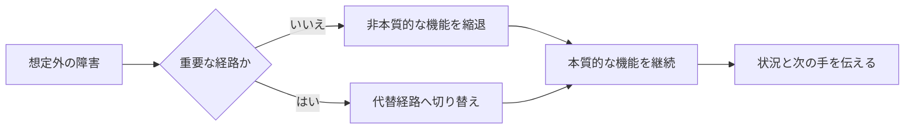

# 優雅になりたい

> 壊れない人間ではなく、壊れたあとも余裕を残せる人間になりたい。

## この記事の結論

「優雅になりたい」という願望を、ソフトウェア設計の Graceful Degradation と重ねて考えました。Graceful Degradation は、一部が使えなくなっても本質的な機能を残し、利用者が目的を達成できるようにする考え方です。

- 優雅さは、完璧な所作ではなく、想定外のあとに残る選択肢で決まる
- 重要なものと、切り捨ててもよいものを先に決めておく
- 自分の復旧だけでなく、周囲に状況と次の手を返す

この話でいう「人生に実装する」は比喩です。人間を TypeScript で動かせるわけではありません。ただ、壊れ方を設計する視点は、人の振る舞いを考えるときにも使えます。

**優雅さとは、余裕の設計です。** 予定どおりに進める能力だけではなく、予定から外れたときに本質を守り、周囲の人にも判断できる状態を返す能力です。

> この記事は、5分LT「優雅になりたい」の内容に、Graceful Degradationの定義と設計上の補足を加えたものです。技術者にも、技術用語を知らない人にも読めるように書いています。

## 1. 優雅になりたいと思った

最近、クラシック音楽を聴いています。音楽を毎日聴いていると、音だけでなく、聴いている人の姿勢や所作まで整って見えてきました。

そこで「自分も優雅になりたい」と思った。紅茶をこぼしても動じず、予定外の連絡にも静かに返し、何かが起きても場の空気を荒らさない人です。

ここで、クラシック音楽が人を優雅にするという話をするつもりはありません。これは発表の出発点です。理想の人物像を考えたとき、最初に浮かんだのが「何が起きても崩れない人」だった、というだけです。

## 2. 優雅さは、正常系では測れない

平穏なときに丁寧に振る舞うのは、そこまで難しくありません。時間があり、予定どおりで、相手も落ち着いているからです。

難しいのは、予想外が重なったときです。予定が変わる。通信が切れる。発表直前に資料が壊れる。そこで声を荒らげ、判断を止め、周囲にも不安を配るなら、普段の丁寧さは簡単に消えます。

このとき必要なのは、無表情を保つ演技ではありません。次の一手を選べるだけの余裕です。

優雅さを3つに分けると、こうなります。

- 余裕：判断を一つ残せる
- 判断：守るものと諦めるものを決められる
- 配慮：周囲に状況と次の手を返せる

## 3. Graceful Degradationとは何か

MDNは Graceful Degradation を、最新ブラウザーで最善の体験を作りながら、古いブラウザーでも本質的なコンテンツと機能を提供する設計思想として説明しています。

たとえば、新しいAPIが使えない環境で、画面全体を空白にするのではなく、別の方法で主要な操作を残す。見た目は落ちます。それでも目的は達成できる。これが「優雅な縮退」です。

Microsoftの信頼性設計でも、コンポーネントが利用できないときに、重要な処理を残すための縮退モードを用意する考え方が示されています。失敗を検知し、代替経路へ切り替え、利用者に何が変わったかを知らせる。ここまでが設計です。



大事なのは、全部を維持しようとしないことです。切るものを決める。残すものも決める。AzureのThrottling Patternでも、非本質的な機能を停止・縮退させ、重要な機能のためにリソースを残す方法として説明されています。完全なレスポンスを諦め、可用性を取る設計です。

設計の段階で、主要な操作、あとで再実行できる処理、失敗しても利用者に直接影響しない表示を分けておけば、障害が起きてから慌てて「全部止めるか、全部通すか」の二択を選ばずに済みます。

たとえば注文サービスなら、商品の閲覧とカートへの保存は続け、在庫の再計算やおすすめ商品の表示は後回しにし、決済だけは安全に確認できるまで保留する、というように目的ごとの優先順位を決めておきます。

## 4. 「例外」を例外のままにしない

コードを書いていると、正常系だけを先に作りたくなります。

```text
Unexpected Event → Panic → Crash
```

この流れでは、想定外が起きた瞬間にシステムの仕事が終わります。人間でいえば、予定変更を受けた瞬間に会話が終わる状態です。

Graceful Degradationでは、想定外の後にも経路を残します。

```text
Unexpected Event → Understand → Adapt → Respond
```

まず、何が起きたかを理解する。次に、守る目的を決める。決める。残す。その目的に必要な最低限だけを残し、別の応答へ切り替える。

全部は無理です。残す。切る。伝える。

ここで「何でも受け入れる」と考えると、少し違います。優雅な設計には、切り替え条件があります。たとえば、データベースが落ちたら書き込みを止めて読み取り専用にする、外部APIが遅ければキャッシュを返す、という具合です。

## 5. ElegantPerson.tsを書いてみる

発表では、人間の振る舞いを TypeScript の形にしました。

```ts
interface ElegantPerson {
  composure: boolean
  consideration: boolean
  adaptability: boolean
}

function handle(event: UnexpectedEvent) {
  try {
    return respondElegantly(event)
  } catch {
    return respondWithDignity()
  }
}
```

これは実行可能な実装ではありません。`UnexpectedEvent` も `respondElegantly` も定義していないので、そのままではビルドできません。

それでも、設計の問いは見えます。余裕はあるか。相手への配慮はあるか。状況に合わせて応答を変えられるか。さらに、最初の応答に失敗したとき、尊厳を保った代替応答はあるか。

人間のコードは、残念ながら型検査を通してから本番に出せません。寝不足、焦り、時間切れという入力が、突然やってきます。だからこそ「失敗しない実装」ではなく、「失敗したときにどこまで保てるか」を考える意味があります。

## 6. 優雅さは、他人に分けられる

システムの縮退で、利用者への通知が重要になります。機能が変わったのに説明がなければ、利用者は壊れたのか、操作を間違えたのか判断できません。

人間も同じです。余裕がなくなったときほど、黙って抱え込むと周囲の選択肢を奪います。

止めない。隠さない。

「いま資料の共有ができません。口頭で続けます」

この一言には、状況の説明と代替経路が入っています。完璧ではない。でも、場は止まりません。

優雅な人は、何も起こさない人ではありません。起きたことを隠さず、次に可能なことを差し出せる人です。自分の余裕を守るだけでなく、周囲の人にも少し分けられる。

## 7. まとめ

想定外はなくせません。ブラウザーの差分も、外部サービスの停止も、寝坊もなくなりません。

だから、先に設計します。何が本質か。どこまでなら落としてよいか。どの条件で代替経路へ切り替えるか。そして、相手に何を伝えるか。

Graceful Degradationは、システムを壊れにくくするための技術用語です。そこから人間の振る舞いを考えるなら、こう言えます。

**優雅さとは、壊れないことではない。壊れたあとも、余裕を残すことである。**

まずは紅茶の淹れ方を勉強します。

Stay Graceful.

### 参考

- [MDN: Graceful degradation](https://developer.mozilla.org/en-US/docs/Glossary/Graceful_degradation) — 本質的な機能を残す設計思想の定義
- [W3C: HTML Design Principles](https://www.w3.org/TR/html-design-principles/) — 古い・能力の低いユーザーエージェントへのフォールバック
- [Microsoft: Architecture strategies for self-healing and self-preservation](https://learn.microsoft.com/en-us/azure/well-architected/reliability/self-preservation) — 縮退モード、代替経路、利用者への通知
- [Microsoft: Throttling Pattern](https://learn.microsoft.com/en-us/azure/architecture/patterns/throttling/) — 非本質的な機能を落として重要な機能を守る考え方
