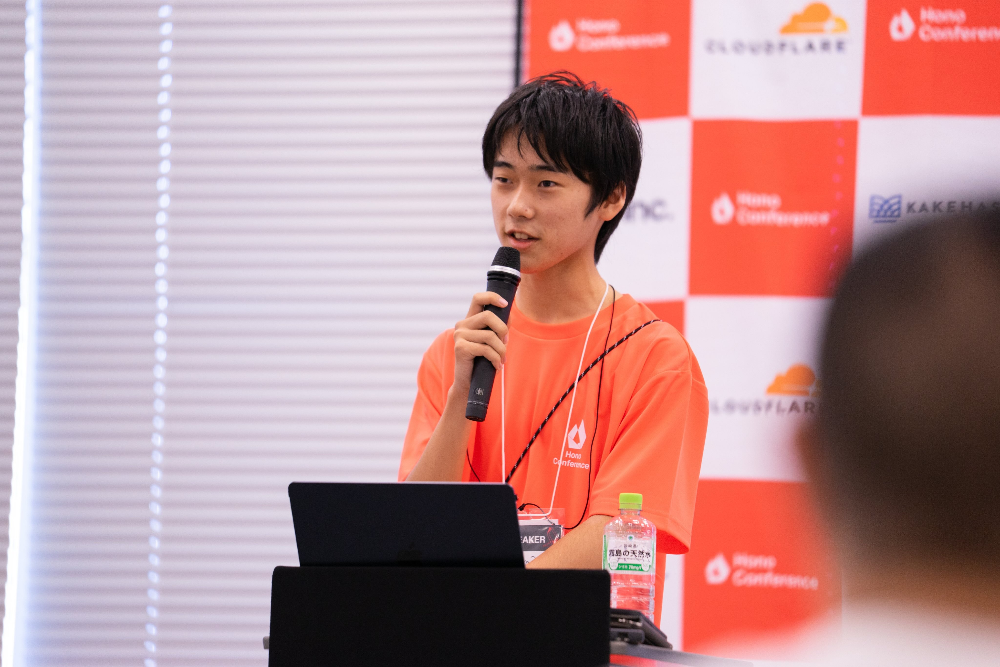
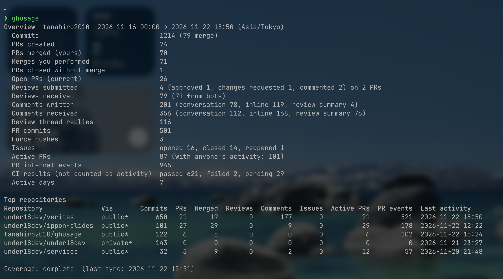

# Rust製CLIを高速化し続けたら、ボトルネックが次々に移動した話

田中博悠 / tanahiro2010

Open Source Conference in Osaka 2027

::note::

ghusageを作っていたら、最初の同期に5分かかりました。そこから遅い場所を一個ずつ直していった話です。

> ▶ まず最初の待ち時間を提示する。

---

## 自己紹介

- 田中博悠 / tanahiro2010
- 三田学園高校の高校1年生
- Web / AI / OSS
- 今日はU18 DevのFounder
- Hono Conference 2026 / GDG Greater Kwansai
- 最近はRust製CLI「ghusage」を開発中

::right::



::note::

田中博悠です。三田学園の高校生で、WebとかAIエージェントを作っています。Hono Conference 2026ではコアスタッフをしていました。

ghusageもそのひとつです。使ってみたら遅かったので、速くしてみました。

今日はU18 DevのFounderとして来ています。普段はWebやAIまわりを触ることが多いですが、今回の主役はRustで作ったCLIです。ghusageを使ってみたら遅かったので、速くしてみました。

---

::center::

問い：自分の作ったアプリ...遅すぎ？！
ってなることないですか？

::note::

自分で作ったアプリを触っていて、「これ、遅すぎない？」ってなることありませんか。僕はghusageの初回同期でなりました。今日は、そのとき何を見て、どこから直していったかを話します。

---

## 今日の話

- 初回同期に5分
- 減らしたら、次は差分同期
- SQLiteを直したら、CIも見直す

::note::

最初はAPIの同期を速くしたかったんですが、直していくと別の場所が目立ち始めました。今日は初回同期、差分同期、SQLiteの集計、最後にCIまで、遅い場所が移っていく順に見ていきます。

---

::center::

前提知識

::note::

ここから先は、ghusageが何をするものかだけ先に紹介します。GitHub APIやSQLiteに詳しくなくても追えるように、必要なところは画面と簡単な図で説明します。

---

## ghusageって何？

- GitHubでの自分の活動をまとめるRust製CLI / TUI
- コミット、PR、レビュー、コメント、CIを同期

::right center::

::qr url=https://github.com/tanahiro2010/ghusage caption::

::note::

ghusageは、自分のGitHub活動をまとめて見るためのCLIです。GitHubのリポジトリもこのQRから見られます。まずは、どんなデータを見られるかを画面で紹介します。

---

## 週の活動をこんなふうに見る

- `weekly` や `daily` で期間ごとの活動を見る
- `prs --details` でPull Requestの詳細を確認
- `reviews`、`comments`、`repos` から切り口を変える

::note::

コミットだけじゃなく、PRやレビュー、コメントも見られます。週単位で振り返ったり、PRごとの動きを追ったりできます。

---

## まずはこの3行

```sh
npm install -g ghusage
ghusage sync
ghusage
```

::note::

npmでインストールして同期すると、GitHubから活動を取ってローカルに保存します。その後はCLIから週や日ごとのレポートを見られます。実際の画面は次に出します。

---

::wide::



::note::

これが実際に動かしている画面です。活動の数やリポジトリごとの集計がターミナルに出ます。便利に使いたかったんですが、最初の同期で待たされました。

---

## 最初の同期に5分

- 30日分の初回同期: 295秒
- APIリクエスト: 2,015回
- これでは、使うたびに待つ

::note::

自分のアカウントで初回同期したら、295秒。5分近く待つことになりました。

---

::center::

遅い

::note::

はい、遅い。まずはそこからです。

---

## まず何を測る？

```sh
GHUSAGE_LOG=ghusage_github=debug ghusage sync --format json
```

- 所要時間と`api.requests`を見る
- ログを並べてAPIの待ち時間を見る

::note::

僕が最初に見たのはこの3つです。実行時間、リクエスト数、それからAPIの開始・終了時刻。

---

## いらないAPI呼び出し

- 更新されていないIssueも毎回詳細取得
- PRごとにCI結果を別リクエストで取得
- 同期段階の間に待ち合わせがあった

::note::

ログを見たら、毎回いらないデータまで取りにいっていました。ここは呼び方を工夫するより、呼ぶ回数を減らせそうです。

---

## Issueは毎回取り直さなくていい

```text
更新時刻が同じ ＋ 前回の取得がcomplete → 詳細取得を省略
更新時刻が違う / 前回の取得が不完全 → 取り直す
```

-# インクリメンタルビルド的な考え方

::note::

Issueの検索結果には更新時刻があります。前回ちゃんと取れていて、その時刻も同じなら、詳細を取り直さなくてよさそうです。

---

## PRと一緒にCI結果も取る

```text
REST:     PR → check runs → statuses
GraphQL:  PR + check runs
          └ statusesがある場合だけREST
```

::note::

PRの情報を取るGraphQLにCI結果も載せました。全部入りきらないときはRESTに戻れるようにしています。

---

## 初回同期は半分以下に

- 295秒 → 124秒
- 2,015リクエスト → 952リクエスト
- 複数の変更をまとめた前後比較

::note::

いろいろ直して、295秒が124秒に。リクエストも半分以下になりました。これは変更をまとめた数字です。

---

## まだ残る待ち時間を分ける

```text
呼ぶ回数を減らす       2,015 → 952
同時に動かす数を増やす  4 → 8
```

- 同じ30日分、同じアカウントで比較
- 集計結果も完全一致

::note::

リクエスト数を減らすのとは別に、同時に動かす数も見ました。4本から8本にして、180秒が124秒。リクエストは952回のままです。数字だけ速くなって、結果が変わっていたら困るので、集計の値が一致することも確認しています。

---

## レポートを続けて見るなら

```sh
ghusage weekly
ghusage daily
```

5分以内の2回目は同期を省く

::note::

weeklyを見てdailyも見たくなる。そのたびに十数秒待つのはもったいないです。直前の同期が5分以内なら同期を省き、最後に同期できた時刻までのレポートを出すようにしました。更新されていないデータを最新のふりはしません。常に取りに行きたい人は `--max-age 0` にできます。

---

::center::

でも、差分はまだ15秒

::note::

初回はだいぶマシ。でも普段使う差分同期はまだ15秒。ここは別の遅さでした。

---

## APIログを時間順に並べる

```text
0.5–2.2s   /search/issues ×3
2.2–3.5s   /graphql (PR)
3.3–10.5s  /search/commits ×9  ← 直列で約7秒
10.5–11.9s /repos/*/commits        (並列)
11.7–14.1s /repositories/<id>/commits ×6 (直列)
```

::note::

ログを並べると、コミット検索だけで約7秒。ページが返るたびに次のページを取りにいっていました。

---

## 1ページ目が返ったら

```text
total_count が分かる
       ↓
2〜10ページを同時に取得
       ↓
ページ順に並べて同期
```

- GitHubの検索結果上限: 1,000件
- 1ページ: 最大100件

::note::

ページ送りを一件ずつ待つ必要はありません。最初の応答で件数が分かるので、残りをまとめて取れます。URL全体を組み立て直すのではなく、GitHubが返した次ページのリンクのページ番号だけを変える形にしました。ホストを検査する既存の安全策もそのまま使えます。

---

## 直列の待ちをほどく

```text
コミット検索 ───────────────┐
PR検索 ── repo一覧 ── default branchのコミット
                            └─ 必要になった時だけ合流
```

::note::

ページを並列にしたあとも、PR検索が終わるまでコミット検索を始めていませんでした。コミット検索自体はPRの結果を必要としません。必要なのは、あとでdefault branchのコミットを取るリポジトリ一覧だけ。そこだけ受け取って合流する形に変えました。

---

## 待つのは必要なところだけ

```text
同時に開始: PR検索 || コミット検索
PRのrepo一覧が必要: default-branch commits の取得だけ待つ
ページ数が分かった: 2ページ目以降をまとめて取得
```

::note::

全部を同時に投げたわけではありません。ページ数が分かった後のページと、互いに依存しない検索を重ねました。

---

## リクエスト数はほぼ同じ

- v0.1.4: 14.8秒 / 45〜47リクエスト
- v0.1.5: 6.2秒 / 46〜47リクエスト
- 公開版の実アカウント比較、各2〜3回

::note::

回数はほぼ同じなのに、平均14.8秒から6.2秒になりました。各バージョンを数回動かしたときの結果です。

---

::center::

速くなった

::note::

数字を見ると、やっと速くなった。これでよし、と思いました。

---

::center::

しかし

::note::

並列にした検索で、不完全な結果が返ることがありました。

---

## 並列化で検索結果が欠けた

- 検索APIが`incomplete_results: true`を返すことがあった
- 不完全なまま同期完了にするとデータが欠ける
- 速さだけでは成功と呼べない

::note::

速くなった。でもGitHubから不完全な検索結果が返ることがありました。データが抜けたままでは困ります。

---

## 不完全なら取り直す

- 不完全な検索を指数バックオフ付きで再試行
- 取れなければCoverageをpartialとして残す
- 不完全な結果で同期カーソルを進めない

::note::

不完全なら少し待って取り直す。それでもダメなら「一部取れてない」と表示するようにしました。試した4回は全部completeで、1回は再取得しています。

---

## 変更行数は「ついで」に取る

```text
PRのコミット行数  → PRクエリに相乗り
その他のコミット  → --diff-stats で100件ずつ
2回目              → 取得済みを再利用
```

::note::

追加削除行数も欲しいとなると、RESTならコミットごとに1回呼ぶことになります。千件なら千回です。PRに含まれるコミット分は、すでに取っているPRのGraphQLに足しました。それ以外は、必要なときだけ `--diff-stats` でまとめて取ります。実アカウントの7日分では、1,153件中472件が追加リクエストなしでした。

---

## APIの次はSQLite

- 集計ベンチの7日分: 131〜173秒
- データ量: 10万イベント
- これはDebugビルドの計測

::note::

APIが落ち着いたと思ったら、今度はローカルの集計が遅い。10万イベントのDebugベンチで、7日分に2分以上かかっていました。

---

::center::

JOINを直した

::note::

SQLiteの実行計画を直しました。10万イベントのDebugベンチで、7日分の集計が2分以上から1〜2秒になりました。

---

::center::
**しかし**

::note::

ただ、Debugの数字が大きく縮んでも話は終わりませんでした。今度はreleaseビルドで集計を測ると、まだ改善できるところが残っていました。

---

## 集計はまだ遅い
- 実行計画を調べ、JOIN順序を修正
- 7日分の集計: 131〜173秒 → 1〜2秒
- それでもrelease集計に改善余地

::note::

JOIN順を直したら、2分以上かかっていた集計が1〜2秒になりました。詳しい話は以前の記事に書いたので、今日はその先です。

---

## 読まなくていい履歴

```text
自分が作ったPR  → 時間指標に過去履歴が要る
他の人のPR      → 期間内の履歴だけ読む
```

::note::

集計に必要なのは、自分が作ったPRの過去履歴だけでした。他の人のPRまで読んでいたので、そこをやめました。出力が変わっていないことも確認しています。

---

## あと26msが縮まらない

- CIランナーの7日p95: 654ms → 226ms
- その後も200msの目標を超えていた
- 推測で直さず、サンプルを採る

::note::

これで226ms。でも目標は200ms。まだちょっと届かないので、プロファイルを取りました。

---

## プロファイルに列名検索が並んでいた

```text
rusqlite::RowIndex::idx
columnName
_platform_strlen
_platform_memcmp
```

::note::

1行に約20列。行ごとに名前で列を探していました。プロファイルを見て、ここが残っていたか、と。

---

## 列の場所は最初に一度だけ調べる

```text
クエリごと  EventCols::of(&stmt)
各行        r.get(idx)
```

::note::

あとは列名ではなく位置で読む。データの中身はそのままで、行の読み方だけ変えました。

---

## 列名参照を変えた結果

- CIランナー・7日: 226ms → 145ms
- CIランナー・30日: 223ms

::note::

CIランナーで測ると、7日分は226msから145msへ、30日分は223msでした。ここは元の記録に643msと654msという別の数字も残っていて、単純な連続比較ではありません。測定条件をそろえて読む必要があります。M4での7日分は93.8msでした。

---

## 待っている間、何が起きてる？

```text
同期中:  6/8 in parallel · 31 requests done
         search commits p3 · 2.1s
         octo/app commits p2 · 1.4s
         repository list · 0.8s
```

::note::

ここは実行時間そのものではなく、待っている間の見え方の話です。最初は無言で、止まったのか分かりませんでした。2行の進捗を出し、並列化した後は「何本走っていて何が動いているか」も見えるようにしました。端末以外では何も出さず、短い同期では表示もしません。同期が終われば表示を消します。

---

## コミット詳細は一度取ればいい

```text
初回: GitHubから取得 → SQLiteに保存
次回: SQLiteから表示
      ネットワークなし / offlineでも開ける
```

::note::

PRの詳細からコミットのdiffを開くときも、毎回GitHubを待っていました。SHAが同じならコミットの内容は変わらないので、取った詳細をキャッシュします。2回目からはオフラインでも開けて、初回の取得中もTUIの操作は止めません。

---

::center::

CIも13分

::note::

「Actionsを並列にできない？」と聞かれて、まずログを見ました。

---

## CIの中で2分待っていた

- `cargo test`がOSごとに6〜8分
- 集計テスト1回が131〜173秒
- CI設定より先に製品の集計処理を直す

::note::

ベンチマークのテストモードでキャッシュを読む1回が、2分以上かかっていました。CIの並列化を急がなくてよかった。

---

## 同じ入力なら、もう検証済み

```text
入力ファイルのハッシュを計算
       ↓
同じOSで成功済み？ ── Yes → 中身を省略して成功
       └──────────── No  → いつものCI
```

- 同じブランチの古い実行もキャンセル
- 同じ内容の再実行: 11.6分 → 約25秒

::note::

ドキュメントだけ変えたのに、毎回すべてのOSで全部走るのは待ちます。前回成功した入力ファイルの組み合わせを記録しておき、同じなら中の検証を飛ばします。必須チェック自体は成功を返す。ファイルが空だったら誤って全部スキップしないよう、そこはエラーにします。

---

## CIの仕事を分けた

```text
テスト / release build    別ジョブで実行
fmt / 重い集計テスト      Ubuntuに集約
Windows                   rust-lldを使う
dev push                  release buildをskip
```

::note::

テストとrelease buildを別ジョブにしました。fmtと重い集計テストはUbuntuに寄せて、Windowsではrust-lldを使います。dev pushではrelease buildを走らせません。

---

## CIの時間も縮んだ

```text
SQLite修正             約13分 → 約8分
test / buildを分離      8.3分 → 6.7分
OSの重複 + rust-lld     6.7分 → 5.0分
devでrelease buildなし  5.0分 → 3.0分
```

::note::

一つの変更で一気に縮んだわけではありません。特に最後の3分は、dev pushでrelease buildを省いた条件です。

---

## テストが不安定だと、やり直しで遅い

```text
以前: 遅いランナーで受信数が揺れる → CIを再実行
変更: サーバーの受信数ではなく、クライアントの再試行回数を検証
```

- 期限も300msから1秒へ
- 確認したい「最大5回」は維持

::note::

これは処理時間を縮めた話ではありません。ただ、Windowsの遅いランナーでタイムアウトのテストが不安定で、数分のCIをやり直していました。テストが確かめたいのはクライアントの再試行回数です。サーバーに何回届いたかは、遅い環境だと最後のリクエストが届く前に期限が切れる。見る場所をクライアント側に移しました。

---

## ベンチ結果をPRで見る

```text
同じランナーで 基準版 → PR版
中央値 / p95 / 変化率をコメント
```

- 基準版が遅すぎて60分で止まったこともある
- 変更のない処理に約10%差が出たこともある

::note::

手元のマシンは他の作業でも負荷が大きく、結果が信用できない時がありました。そこでrelease向けPRでは、同じランナーで基準版とPR版を測ってコメントします。ただし毎回基準版から先に測るので、測定順の偏りは残ります。変更していない処理まで10%遅く見えたことがあり、ここはまだ改善したいところです。

---

## dev pushなら3分

```text
dev push    test / clippy     release buildなし
release PR  test / clippy / release build
同じ入力    検証済みの結果を再利用
```

::note::

3分だったのはdevへのpushです。release向けCIまで3分になったわけではありません。同じ内容の再実行なら、前の結果を使って約25秒で終わります。

---

## ページキャッシュは戻した

```sql
PRAGMA cache_size = -32768; -- 32 MiB
```

- 高負荷で測定値が2〜6倍に揺れた
- 効果を判断できず、設定を撤回

::note::

SQLiteのページキャッシュを広げたら速くなるかも、と思って試しました。でもマシンの負荷で数字が2〜6倍も揺れて、効果が分からない。いったん戻しました。

---

::center::

ビルドが6秒短くなった

::note::

AWS-LCからringに替えたときのclean buildの結果です。

---

## まずコンパイルの内訳を見る

```sh
cargo build --timings
```

```text
dev clean     44秒
release clean 62秒
aws-lc-sys    dev 23秒 / release 27秒
```

::note::

「Rustのビルドが遅い」と感じても、どこが遅いかは別の話です。timingsを見ると、暗号ライブラリのビルドスクリプトが大きく見えました。でも開発ビルド全体の時間を決めていたわけではありませんでした。

---

## それでも採用しなかった

- TLSライブラリ変更でclean build: 62秒 → 56秒
- 暗号ライブラリ変更のコストに見合わない
- ビルド時間の差で、実行時性能の差ではない

::note::

ビルドは6秒短くなりました。でも暗号ライブラリを替えるほどの差かな？ と思って、これは採用しませんでした。実行時の速さを測った数字でもありません。

---

## 変えていないのに10%ずれた

- 固定順の測定で、変更していない処理に約10%差
- 実装変更では説明できない結果
- 環境や順序の影響は仮説のまま

::note::

変更していない処理まで10%くらい遅く見えたことがありました。測る順番のせいかもしれない。まだ原因は分かっていません。

---

## 次に試したいこと

- ベンチマークを基準→PRではなく、交互に測る
- 初回同期は検索APIの回数そのものを減らす
- 結合テストのリンク回数を減らす

::note::

ここから先はまだ候補です。交互に測るのは、順番の偏りを減らしたいから。初回同期は並列化だけでは限界があり、検索APIのレート制限に当たります。呼ぶ回数そのものを減らせるかを考えています。

---

## 直すと次が遅くなる

```text
API       仕事の量を減らす
通信      待つ順番を変える
SQLite    読むデータと列を見直す
CI        実行する仕事を選ぶ
```

::note::

最初はAPI、次は通信の待ち時間、その次はSQLiteの読み込みとCI。直すたび、次に遅いところが見えてきました。

---

## まとめ

- 僕も最初は「遅い」としか分からなかった
- 計測すると、次に見る場所が見えた
- 速さとデータの正確さは一緒に見る

::note::

295秒を直したら、次は差分同期。そこを直したら、今度は集計とCI。僕の高速化はずっとこの繰り返しでした。

---

## ghusage

- GitHub: https://github.com/tanahiro2010/ghusage
- 高速化の施策と計測条件はリポジトリの記録を参照

::note::

ソースコードも公開しています。気になったらGitHubを見てみてください。ありがとうございました。
