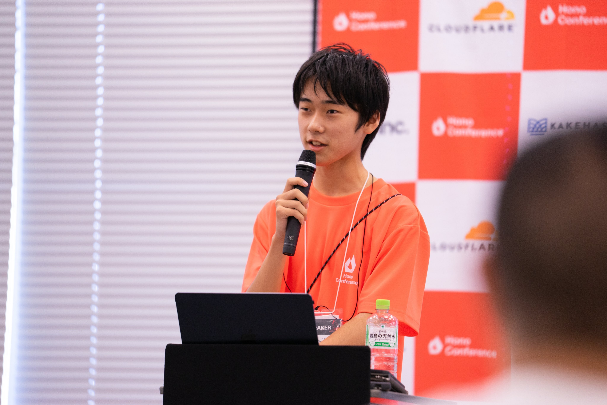
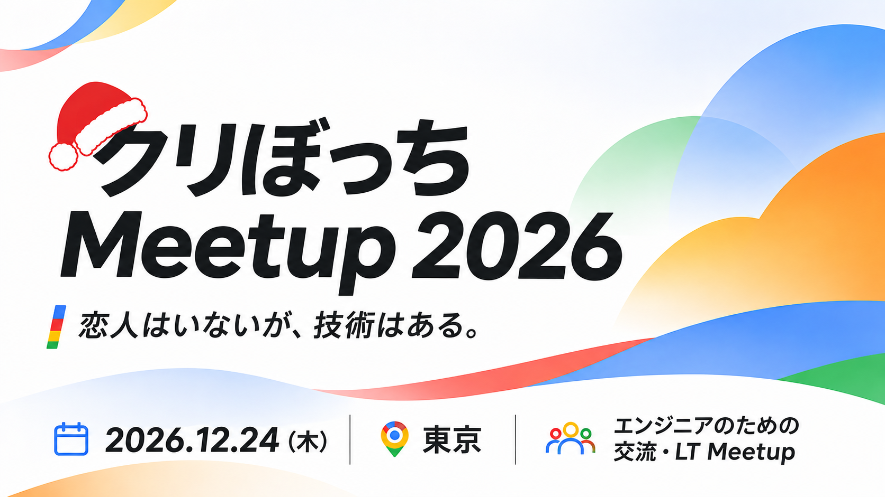

::title::

# 怠惰は人を健康にするのか？

田中博悠

2050 Project Fes 2026 ・ December 12, 2026

::note::

> ▶ タイトルは読まずに、そのまま次へ。

> ▶ 全 23 枚・想定 5 分。巻くなら ①「怠惰、心当たりない？」の挙手 → ②「副作用もある」の個人情報保護法の話 → ③「Laziness（怠惰）」 の順で薄くする。

---

## 田中博悠 / tanahiro2010

- 高校生 / 個人開発者 / コミュニティ運営者
- Under18 Developers / Alpha+ Project
- (今回紹介する)E.D.I.T.H を開発中
- GitHub / X: @tanahiro2010

::right center::

::note::

田中博悠です。高校生で、Under18 Developers と Alpha+ Project で活動しています。普段は Web や AI まわりを触っています。

> ▶ E.D.I.T.H の話はあとでするので、ここでは名前だけ。**15 秒で切る。**

---

::center::

皆さん、怠惰ですかァ？

::note::

皆さん、怠惰ですかァ？

> ▶ ペテルギウス風。**大げさに、首を傾けて。** 言ったあと 2〜3 秒黙って客席を見回す。元ネタの説明はしない。

---

## 怠惰、心当たりない？

- アラームのスヌーズを何度も押す
- 皿洗いを明日に回す
- 「あとで返信する」と言って3日放置する

::note::

アラームのスヌーズ、何回押しました？　お皿、明日でいいやって思いました？　「あとで返信する」って言って、3 日経ってません？

> ▶ テンションは保ったまま。余裕があれば「心当たりある方」と軽く手を挙げてもらう。押していたら挙手は省く。

---

::center::

怠惰ですねェ

::note::

怠惰ですねェ……！

> ▶ **ここが芝居のピーク。** 一番大げさに。すぐ次へ。

---

::center::

今日はそんな「怠惰」とヘルスケアの話

::note::

……はい。失礼しました。

今日はそんな「怠惰」と、ヘルスケアのお話です。

> ▶ **急に素に戻る。** 声のトーンを落として一拍。笑いが来たら待つ。

---

## エンジニアの三大美徳

- Laziness（怠惰）
- Impatience（短気）
- Hubris（傲慢）
- Larry Wall提唱のプログラマの美徳

::note::

でも、エンジニアの世界だと、怠惰って褒め言葉なんです。Perl という言語を作った Larry Wall が、プログラマの三大美徳というのを言っています。怠惰、短気、傲慢。全部悪口に聞こえますけど、全部褒め言葉です。

> ▶ さっきの「怠惰ですねェ」との**落差を出す。** 今日は「怠惰」だけ。Perl の歴史や他の 2 つには踏み込まない。

---

## 今日話すこと

- エンジニアの「怠惰」って何？
- 人の名前を思い出す手助けをするプロジェクトを作っている
- 楽になる = 健康？

::note::

今日話すことは 3 つです。エンジニアの「怠惰」とは何か。その発想で、人の名前を思い出す手助けをするものを作っていること。そして、楽になることは健康につながるのか、ということです。

> ▶ 最後にこの 3 つへ戻ってくる。

---

## Laziness（怠惰）

> The quality that makes you go to great effort to reduce overall energy expenditure.

-# perldoc.perl.org（Programming Perl 用語集）

- 繰り返す面倒を減らすために、今がんばる性質
- 日常語の「なまけ」とは逆の、逆説的な美徳

::note::

全体の手間を減らすために、今あえて大きな努力をする。これがエンジニアの言う「怠惰」です。さっきのスヌーズとは真逆ですね。面倒を減らすために、面倒なことをするんです。

> ▶ **英文は読み上げない。** 日本語の言い換えだけ。

---

## 面倒だから自動化する

- エンジニアは怠惰
- 面倒だから自動化する
- パスワードは覚えない → パスワードマネージャーに任せる

::note::

エンジニアは怠惰なんです。面倒だから自動化する。たとえばパスワード。全部覚えるのは無理なので、パスワードマネージャーに覚えてもらいます。覚える手間は、仕組みに任せればいい。

---

::center::

じゃあ、人の名前は？

::note::

……じゃあ、人の名前は？

> ▶ **一拍。** ここから自分の話へ。

---

::center::

人の名前を覚えるのが致命的に苦手

::note::

具体的には、一年クラスメート同じなのに、年末に覚えてるクラスメートの数は3人くらい。
それくらいには苦手。

> ▶ 笑いが来たら待つ。

---

## E.D.I.T.H

- 「覚えていなくても、名前がわかる。」
- 一度会った人の名前を、その場で思い出す手助けをするプロジェクト
- 個人開発中のコミュニケーション支援システム

::note::

だったら、パスワードと同じで、全部を頭の中に置いておかなくてもいいんじゃないか。そう思って作っているのが E.D.I.T.H です。キャッチコピーは「覚えていなくても、名前がわかる。」

> ▶ キャッチコピーは**ゆっくり読む。** 技術スタックや構成には触れない。

---

## で、何してるの？

- 顔を認識して、登録済みの人物の名前を表示する
- 目指しているのは、まず「顔を見れば名前がわかる」ところ
- 人間の記憶を全部肩代わりするわけじゃない

::note::

やっていることはシンプルで、スマートグラスで顔を認識して、登録しておいた人の名前を表示します。今の目標は、まずそこまでです。

人の名前をすべて覚えようとしなくても、必要なときに思い出す手段があれば、もう少し気楽に人と話せるかもしれない。

> ▶ **聞かれたら:** 脳と外部ストレージのたとえは、あくまで比喩。人間の記憶がデータベースと同じ構造だという主張ではない。

---

::center::

で、これって健康の話？

::note::

……と、ここまで E.D.I.T.H の話をしてきましたけど、今日はヘルスケアのイベントです。

名前を思い出せるようになること。これって、健康と関係あるんでしょうか？

> ▶ **一拍。** 客席に問いかけるように。ここで話をヘルスケアへ戻す。

---

## そもそも、健康って？

- WHO: 身体・精神・社会的に良好な状態（1946）
- 病気がないことだけじゃない
- 人と気楽に話せる → 社会的な健康の一部かも

::note::

そもそも、健康って何か。WHO は 1946 年に、健康を「身体的・精神的・社会的に良好な状態で、単に病気がないことではない」と定義しています。

ポイントは「社会的」。人と気楽に話せることも、健康の一部と言えるかもしれません。だとすると、名前を覚える負担が減れば、健康にも効く……んでしょうか。

> ▶ **聞かれたら:** この定義には「complete（完全な）は厳しすぎる」という批判もある（Huber et al., BMJ 2011）。

---

## その怠惰、マジで健康？

- 記憶を外部に頼ることで、人間の能力はどう変わるのか
- 支援されることを、本人が望んでいるとは限らない
- 名前を覚えるために、他人の顔情報を扱う重み

::note::

……でも、話はそんなに単純じゃないんです。

記憶を外に頼ったら、人間の能力はどう変わるのか。支援されることを、本人が望んでいるとは限らない。そして、名前を覚えるために、僕は他人の顔を扱っている。

覚えなくてよくなる。それは楽かもしれません。でも、便利になることと、健康になることって、同じなんでしょうか？

> ▶ **ここで反転。** 声を少し落とす。

---

## 副作用もある

- 顔認識には精度の偏り → 暗い肌の女性で誤り率は最大34.7%（Gender Shades, 2018）
- 日本では顔の特徴データは「個人識別符号」→ 登録には原則本人の同意が必要
- 記憶力への影響は、まだよくわかっていない

::note::

薬に副作用があるように、この怠惰にも副作用があります。顔認識には精度の偏りがあります。2018 年の研究では、商用の顔認識で、暗い肌の女性の誤り率が最大 34.7% でした。

日本でも、顔の特徴データは個人情報保護法の「個人識別符号」で、登録するなら原則として本人の同意が要ります。この「本人」は、グラスをかけている僕じゃなくて、映される側の人です。

一方で、記憶を外に出すと記憶力が落ちるのかは、実はまだよく分かっていません。

> ▶ **数字は 34.7% だけ強調。** 「記憶力が落ちる」とは言い切らない。

---

## じゃあ、2050年は？

- 負担を減らせる未来は望ましいかも
- でも「何を減らすべきか」は、エンジニアだけでは決められない
- 名前を覚えることは、負担なのか、関係を築く過程なのか

::note::

このイベントのテーマは 2050 年です。負担を減らせる未来は、たぶん望ましいです。でも、何を負担として減らすかを、作る側のエンジニアだけで決めていいわけじゃない。

人の名前を覚えることは、ただの負担なのか。それとも、その人との関係を築く過程の一部なのか。答えは、人によっても状況によっても違うと思います。

2050 年に必要なのは、すべてを自動化する技術じゃなくて、何を自分でやって、何を技術に任せるかを選べる社会なのかもしれません。

> ▶ 医療・ヘルスケアの話に**ここでつなぐ。**

---

## まとめ

- 怠惰 → 面倒を減らすための工夫
- E.D.I.T.H → 名前を覚える負担を技術で肩代わりする試み
- 楽になる = 健康 とは、まだ言えない

::note::

まとめです。エンジニアにとっての怠惰は、面倒を減らすための工夫。E.D.I.T.H は、名前を覚える負担を技術で肩代わりする試み。でも、楽になることが健康につながるかどうかは、まだ言えません。

> ▶ 「今日話すこと」の 3 つを回収するだけ。**締めの前に一拍。**

---

::center::

人間は、どこまで怠惰になっていいのか？

::note::

エンジニアは、怠惰を美徳とします。でも、人間のどんな努力を減らすべきなのかは、エンジニアだけでは決められません。

だからこそ、医療に関わる皆さんにも聞いてみたい。

人間は、どこまで怠惰になっていいのでしょうか？

> ▶ **最後はゆっくり。** 答えは言わずに、一拍置いて宣伝へ。

---

## 宣伝: クリぼっち Meetup 2026

- 2026/12/24（木）19:00〜・東京都内
- 参加無料・LT 枠あり

::right center::

::qr url=https://under18dev.connpass.com/event/412230/ caption::

::note::

最後に宣伝です。12 月 24 日、クリスマスイブに、僕が主催でクリぼっち Meetup をやります。「恋人はいないが、技術はある。」。参加は無料で、LT 枠もあります。恋人がいないことは参加条件じゃないので、予定がある人も来てください。

> ▶ **素に戻って明るく。** QR を指して数秒待つ。10 秒で切る。
---

Thanks for listening!

::right center::

::qr url=https://blog.tanahiro2010.com/articles/lazy-for-health caption::

::note::
ブログ記事もあります。
ぜひ読んでください